# 星载斜视 SAR 的 CS 算法图解与 MATLAB 实验

从斜距和二维频谱，到三个可运行的相位滤波器

**适合读者：** 刚开始学习 SAR 成像的研究生。距离向时间记为 $\tau$，方位向时间记为 $\eta$。本文沿用前一份《星载斜视SAR变等效速度精确频谱推导》的几何与傅里叶符号，继续回答“怎样把频谱公式变成成像步骤”。

**本次实际完成：** MATLAB 生成独立的中心单点、九点原始回波；CS 完成距离徙动校正和成像；给出过程图、关闭 RCMC 的对照、逐点位置及剖面检查。生成器、处理器和评价器相互分开。所有新增 MATLAB 文件的非空可执行代码行均附有中文注释。

**适用边界：** 每个目标的 $V_r(r)$ 在合成孔径内恒定，不同距离的目标使用不同速度。本实验是 ERS 量级雷达参数、5° 斜视、短有效矩形孔径的等效双曲模型仿真。经典 CS 使用驻相和距离频率二阶近似；它并没有因为起点是精确积分，就成为任意大斜视、任意宽带、真实轨道的精确反演。

## 1. 先明确任务：为什么压缩脉冲以后还要校正距离？

### 1.1 一幅原始回波矩阵里装了什么

想象雷达连续发射许多次脉冲。固定某一次发射，接收机按时间顺序记录一串复数，这一串就是矩阵的一行。下一次发射得到下一行。因此，本项目矩阵的**行是慢时间，列是快时间**。

“快时间”指一次发射后等待回波的时间，决定目标大约有多远；“慢时间”指平台运动过程中各次发射的时刻，决定从哪些位置看到了目标。“复数”包含两个实数分量，既保存强弱，也保存振荡所处的阶段；后者就是相位。成像需要让同一目标在不同脉冲里的相位对齐后相加。

单次发射是一个较长的调频脉冲。距离压缩把它变成较窄的响应，但平台仍在运动，同一目标的双程传播时间仍在变化。其峰值会横跨多个距离采样单元，这种移动叫**距离徙动**，英文简写 RCM。把移动补回去叫 RCMC。

### 1.2 CS 准备怎样解决这个问题

CS 是 Chirp Scaling 的缩写，可理解为“利用调频相位，改变距离响应的排列方式”。此处不是 compressed sensing，也不是压缩感知。方法的核心是：先乘一个设计好的二次相位，让不同距离目标的不同迁移量变成同一个偏移，再在频域用一次共同平移将其消除。

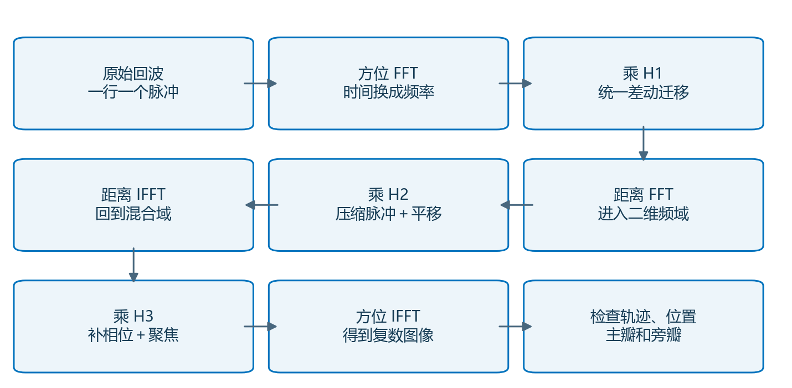

图1 先读框里的动作，再读下面各节推导：第2节定几何，第3节定回波，第4节把前文频谱改写成距离调频形式，第5至7节依次设计 H1、H2、H3，第8至11节解释距离空变与实际验证。

**本节交接：** 要知道该把距离峰值移到哪里，必须先区分最近斜距、波束中心斜距和慢时间原点。

## 2. 建立几何：波束中心为零，不代表距离最小

### 2.1 三个时间与两个距离

对一个目标，记 $r$ 为最近斜距，$\eta_b$ 为波束中心经过该目标的时刻，$\eta_{\min}$ 为目标距离最小时刻。参考目标取 $\eta_b=0$，其他目标一般具有各自的 $\eta_b$。令 $V=V_r(r)$，$\theta$ 是从正侧视方向朝前偏转的斜视角。等效双曲模型为：

$$
\boxed{R(\eta;r,\eta_b)=\sqrt{r^2+V_r^2(r)(\eta-\eta_{\min})^2},\qquad
\eta_{\min}=\eta_b+\frac{r\tan\theta}{V_r(r)}.}\tag{2.1}
$$

式（2.1）中 $R,r$ 单位为 m，$V_r$ 为 m/s，$\eta$ 为 s。第一项是最近距离的平方，第二项是目标偏离最近点时的等效沿航向位移平方。对同一个目标计算整个孔径时，$r$ 和 $V_r(r)$ 都固定；换一个距离的目标，二者同时改变。

把 $\eta=\eta_b$ 代入，先计算时间差，再计算距离：

$$
\begin{aligned}
\eta_b-\eta_{\min}&=-r\tan\theta/V,\\
R_b^2&=r^2+V^2(r\tan\theta/V)^2
=r^2(1+\tan^2\theta)=r^2/\cos^2\theta,\\
R_b&=r/\cos\theta,\qquad \lvert\theta\rvert<90^\circ.
\end{aligned}\tag{2.2}
$$

式（2.2）说明波束中心斜距 $R_b$ 大于最近斜距 $r$。取平方根时选择正值，因为距离为正；最后使用 $1+\tan^2\theta=1/\cos^2\theta$。只有 $\theta=0$ 时，两种距离和两种时刻才分别重合。

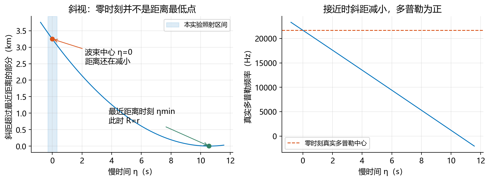

图2 参考目标的最近距离时刻约在波束中心之后10.6 s，远在本实验0.6 s有效照射区间之外。成像并不要求真的采到最近点；需要的是一致的斜距模型和正确的相位补偿。

### 2.2 速度随距离变化从哪里来

为提供一条平滑、量级合理且能复现的速度标定曲线，设球形地球半径为 $R_e$，圆轨道半径 $R_s=R_e+h$，其中高度 $h$ 和两个半径单位均为m；地球引力参数 $\mu$ 单位m³/s²，角速度 $\omega=\sqrt{\mu/R_s^3}$ 单位rad/s。忽略自转，目标相对轨道平面的夹角参数记为 $\gamma$。最近时刻附近的真实圆轨道距离满足：

$$
R_{\rm circ}^2(u)=R_s^2+R_e^2-2R_sR_e\cos\gamma\cos(\omega u),
\qquad r^2=R_s^2+R_e^2-2R_sR_e\cos\gamma.\tag{2.3}
$$

式（2.3）的 $u$ 是相对最近时刻的时间，单位s。用 $\cos(\omega u)=1-(\omega u)^2/2+O(u^4)$ 代入，常数项合并成 $r^2$，二次项为 $R_sR_e\cos\gamma\,\omega^2u^2$。将其与等效模型 $r^2+V_r^2u^2$ 的二次项相匹配：

$$
\boxed{V_r^2(r)=R_sR_e\cos\gamma\,\omega^2
=\frac{\mu(R_s^2+R_e^2-r^2)}{2R_s^3}.}\tag{2.4}
$$

式（2.4）第二个等号使用式（2.3）中的 $2R_sR_e\cos\gamma=R_s^2+R_e^2-r^2$ 和 $\omega^2=\mu/R_s^3$。它的单位为 m²/s²。此速度反映斜距曲线的弯曲程度，不等于轨道切向速度 $\sqrt{\mu/R_s}$。

**近似放在哪里：** 代码先用式（2.4）建立距离—速度标定表，再用式（2.1）生成回波；没有用圆轨道欧氏距离生成回波后宣称完全聚焦。保存的圆轨道轨迹只用于描述参数来源和轨道示意，数据字段明确写明其用途。

**本节交接：** 几何已经给出了每个脉冲的距离。下一步仅用传播时间与传播相位，把它变成原始回波。

## 3. 从距离到原始回波，再到距离频谱

### 3.1 先把时延、调频和传播相位分开

设载频为 $f_c$（Hz），波长 $\lambda=c/f_c$（m），脉宽 $T_p$（s），调频带宽 $B$（Hz），距离调频率 $K_r=B/T_p>0$（Hz/s）。定义 $w_r(t)=1$ 当 $\lvert t\rvert\le T_p/2$，其余为0；这就是有限矩形脉冲包络。$w_a(\eta-\eta_b)$ 是有效孔径包络，本实验在 $\lvert\eta-\eta_b\rvert\le T_a/2$ 时为1，其中 $T_a$ 为有效照射时长，单位s。

$$
\boxed{\begin{aligned}
p(t)&=w_r(t)e^{j\pi K_rt^2},\qquad \tau_d(\eta)=2R(\eta)/c,\\
s(\tau,\eta)&=\sigma w_a(\eta-\eta_b)
p[\tau-\tau_d(\eta)]e^{-j4\pi f_cR(\eta)/c}.
\end{aligned}}\tag{3.1}
$$

式（3.1）的 $\sigma$ 为目标复散射系数。$2R/c$ 是去程与回程的总时间；$p(\tau-\tau_d)$ 将发射波形延迟到接收时刻；最后一个指数是双程载频传播相位。它们承担不同任务，距离压缩不能把传播相位一并删除。$j^2=-1$，$e^{j\phi}=\cos\phi+j\sin\phi$ 表示相位为 $\phi$ 的单位复数。

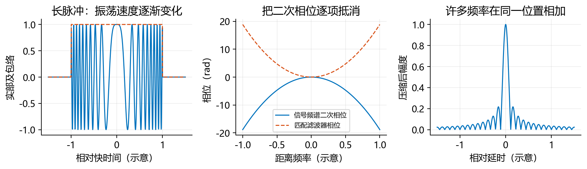

图3 长脉冲在距离方向占许多采样点；给频谱乘相反的二次相位后，各个频率在同一延时位置相加，形成窄峰。

### 3.2 傅里叶符号决定所有滤波器的正负号

傅里叶变换把不同的振荡速度分开记录。本实验定义：

$$
S(f_\tau,f_\eta)=\iint s(\tau,\eta)e^{-j2\pi(f_\tau\tau+f_\eta\eta)}\,d\tau d\eta.
\tag{3.2}
$$

式（3.2）的 $f_\tau,f_\eta$ 单位均为Hz。逆变换使用正号。矩阵上对列做FFT对应快时间变为 $f_\tau$，对行做FFT对应慢时间变为 $f_\eta$。本文将 $f_\eta$ 也简写为 $f_a$，将去掉多普勒中心后的频率另记为 $f_b$，二者不能互换。

对延迟脉冲令 $u=\tau-\tau_d$，则 $\tau=u+\tau_d$、$d\tau=du$。将其完整代入积分：

$$
\begin{aligned}
\int p(\tau-\tau_d)e^{-j2\pi f_\tau\tau}d\tau
&=\int p(u)e^{-j2\pi f_\tau(u+\tau_d)}du\\
&=e^{-j2\pi f_\tau\tau_d}\int p(u)e^{-j2\pi f_\tau u}du
=P(f_\tau)e^{-j2\pi f_\tau\tau_d}.
\end{aligned}\tag{3.3}
$$

式（3.3）给出“延迟对应负的线性频率相位”。因此距离频域—方位时域的回波为：

$$
\boxed{S(f_\tau,\eta)=\sigma w_a(\eta-\eta_b)P(f_\tau)
\exp\left[-j\frac{4\pi(f_c+f_\tau)R(\eta)}c\right].}\tag{3.4}
$$

式（3.4）中 $f_c+f_\tau$ 同时乘几何距离，表达了距离和方位之间的关联。前一份文档已经推导出这个表达式；本节通过变量替换再次说明了其时延符号。

### 3.3 发射脉冲的二次频谱相位如何产生

把脉冲变换积分中的相位配方：

$$
\pi K_rt^2-2\pi f_\tau t
=\pi K_r\left(t-\frac{f_\tau}{K_r}\right)^2
-\frac{\pi f_\tau^2}{K_r}.\tag{3.5}
$$

将右侧平方展开，会得到 $\pi K_rt^2-2\pi f_\tau t+\pi f_\tau^2/K_r$，最后一项再减去，便恢复左侧。因此这是恒等式。对较大的 $BT_p$，并在脉冲频谱主体内远离边缘时，积分中缓慢变化的幅度可另记为 $A_p(f_\tau)$，主要二次相位为：

$$
P(f_\tau)\approx A_p(f_\tau)e^{-j\pi f_\tau^2/K_r},\qquad
H_r(f_\tau)\approx e^{+j\pi f_\tau^2/K_r}.\tag{3.6}
$$

式（3.6）的 $H_r$ 仅对发射波形频谱的二次相位取共轭，不对整个回波取共轭。完整匹配滤波器是 $P^*$；此处的相位式省略幅度权和公共增益。本实验不额外硬截距离频谱，以避免将有限脉冲的频谱尾部当成严格为零；有限脉冲由原始回波自身保存。

**本节交接：** 普通 $H_r$ 尚未处理几何造成的二次频率相位。下面从前文的平方根频谱，找出混合域里真正应该压缩的调频率。

## 4. 从已推导频谱得到 CS 的出发信号

### 4.1 先保留完整平方根，再明确在哪一步展开

前文第7节给出双曲模型的驻相点相位，第8节说明它作为有限孔径频谱近似使用的条件。将缓变幅度统一记为 $A$，则：

$$
\boxed{S(f_\tau,f_a;r)\approx A(f_\tau,f_a;r)P(f_\tau)
e^{-j\frac{4\pi r}{c}\sqrt{(f_c+f_\tau)^2-\beta^2}}
e^{-j2\pi f_a\eta_{\min}},\qquad
\beta=\frac{cf_a}{2V_r(r)}.}\tag{4.1}
$$

式（4.1）中的近似号来自有限孔径驻相近似；根号内的相位本身未作时间二次展开。$A$ 包括散射、孔径权和驻相幅度，也可以含公共常相位。它不是任意常数；后续CS相位设计假定它在局部处理频带内变化较缓。

令 $G=\sqrt{(f_c+f_\tau)^2-\beta^2}$，$D=\sqrt{1-(\beta/f_c)^2}>0$。计算距离频率导数时固定目标 $r$ 和 $f_a$，所以 $V_r(r)$ 也固定。逐步求导：

$$
\begin{aligned}
G'&=(f_c+f_\tau)/G,\\
G''&=1/G-(f_c+f_\tau)G'/G^2\\
&=\{G^2-(f_c+f_\tau)^2\}/G^3=-\beta^2/G^3,\\
G(0)&=f_cD,\quad G'(0)=1/D,\quad
G''(0)=-\beta^2/(f_c^3D^3).
\end{aligned}\tag{4.2}
$$

式（4.2）每一撇都表示对 $f_\tau$ 求导。第二行使用乘积和商的导数，第三行将 $G^2=(f_c+f_\tau)^2-\beta^2$ 代入分子。由泰勒公式“函数值＋一阶导数乘偏移＋二阶导数乘偏移平方除以2”，得到：

$$
G(f_\tau)\approx f_cD+\frac{f_\tau}{D}
-\frac{\beta^2f_\tau^2}{2f_c^3D^3}.\tag{4.3}
$$

式（4.3）是经典CS的频谱二阶截断。它不是等式；大斜视或大带宽时，必须重新检查三阶及以上余项。

### 4.2 把常数、一次和二次频率项分别收集

将式（4.3）和（3.6）代入式（4.1）。零阶项不含 $f_\tau$，一次项给脉冲位置，二次项决定距离压缩的调频率：

$$
\begin{aligned}
S(f_\tau,f_a;r)\approx{}&B(f_\tau,f_a;r)
e^{-j4\pi f_crD/c}e^{-j2\pi f_a\eta_{\min}}\\
&\times e^{-j2\pi f_\tau\tau_r}
e^{-j\pi f_\tau^2/K_m(r,f_a)},\qquad
\tau_r=\frac{2r}{cD}.
\end{aligned}\tag{4.4}
$$

式（4.4）不表示正侧视；其中 $f_a$ 是包括斜视中心的真实方位频率，$\eta_{\min}$ 也不被设成0。这里将慢变的 $A A_p$ 合并成 $B$。其一次频率相位 $-2\pi f_\tau\tau_r$ 对应迁移中的距离时延，随 $f_a$ 改变。

把二次项写在同一行后比较系数：

$$
\begin{aligned}
-\frac{\pi f_\tau^2}{K_m}
&=-\frac{\pi f_\tau^2}{K_r}
+\frac{2\pi r\beta^2f_\tau^2}{cf_c^3D^3},\\
\boxed{\frac1{K_m(r,f_a)}
=\frac1{K_r}-\frac{2r\beta^2}{cf_c^3D^3}
=\frac1{K_r}-\frac{crf_a^2}{2V_r^2(r)f_c^3D^3}.}
\end{aligned}\tag{4.5}
$$

式（4.5）第一行整体除以 $-\pi f_\tau^2$ 后得到第二行；当 $f_\tau=0$ 时用同一多项式的系数定义，不需要除以零。最后一步代入 $\beta^2=c^2f_a^2/(4V_r^2)$，约去一个 $c$ 和因子2。$1/K_m$ 单位是s²，和 $1/K_r$ 一致。

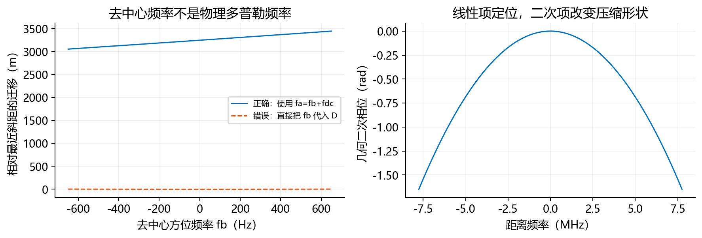

图4 左图中错误曲线接近零，原因是把约21.7 kHz的斜视中心漏掉了。右图的二次相位由几何产生，单用发射脉冲的匹配滤波不能抵消它。

### 4.3 为什么回到快时间后仍是调频信号

对式（4.4）中的距离频率项作逆变换，令 $z=\tau-\tau_r$，相位配方为：

$$
-\frac{\pi f_\tau^2}{K_m}+2\pi f_\tau z
=-\frac\pi{K_m}(f_\tau-K_mz)^2+\pi K_mz^2.\tag{4.6}
$$

展开右侧平方得到 $-\pi f_\tau^2/K_m+2\pi f_\tau z-\pi K_mz^2$，再加最后一项，恢复左侧。若局部积分的幅度变化较慢，平方积分提供公共因子和缓变包络，剩下的相位为 $+\pi K_mz^2$。对于有限脉冲，这是渐近近似而非有限区间的精确傅里叶对。由此得到CS的混合域相位模型：

$$
\boxed{S_1(\tau,f_a;r)\approx B_1(\tau,f_a;r)
e^{j\pi K_m(\tau-\tau_r)^2}
e^{-j4\pi f_crD/c}e^{-j2\pi f_a\eta_{\min}}.}\tag{4.7}
$$

式（4.7）中的 $B_1$ 保留有限距离脉冲和孔径包络的影响。它没有被宣称在所有快时间处恒定。正式代码从原始数据直接变换，不用式（4.7）合成处理输入。

**本节交接：** 现在已知脉冲中心 $\tau_r=2r/(cD)$ 和调频率 $K_m$。下一步用一个新增二次相位改变该中心的频率依赖。

## 5. 第一个滤波器 H1：把不同迁移变成共同偏移

### 5.1 先说明每个距离段内固定了什么

选本段参考最近斜距 $r_0$，使用 $V_0=V_r(r_0)$ 计算 $D(f_a)$，并将 $K_m(r,f_a)$ 近似为本段 $K_m(r_0,f_a)$。为减少符号，下文第5、6节暂记它为 $K_m$。这不是设全场景速度都相同，而是每个距离段独立选参考；第8节计算分段留下的残差。

定义参考目标在混合域的中心为 $\tau_0=2r_0/(cD)$。本实现选择把最终所有频率对齐到最近斜距，即参考因子 $D_{\rm ref}=1$，因此：

$$
\boxed{a(f_a)=\frac1{D(f_a)}-1,\qquad
H_1(\tau,f_a)=\exp[j\pi K_ma(\tau-\tau_0)^2].}\tag{5.1}
$$

式（5.1）中 $a$ 无量纲。$K_m(\tau-\tau_0)^2$ 无量纲，所以指数是相位。$H_1$ 模长为1，只改变相位，不直接改写采样位置；它对本段所有目标使用同一个 $\tau_0$。

### 5.2 不省略配方步骤

原有调频相位与新增相位相乘后，相位相加。先只看除以 $\pi K_m$ 的部分：

$$
\begin{aligned}
\tau_1&=\frac{\tau_r+a\tau_0}{1+a},\\
(\tau-\tau_r)^2+a(\tau-\tau_0)^2
&=(1+a)\tau^2-2(\tau_r+a\tau_0)\tau+\tau_r^2+a\tau_0^2\\
&=(1+a)(\tau-\tau_1)^2+
\tau_r^2+a\tau_0^2-\frac{(\tau_r+a\tau_0)^2}{1+a}.
\end{aligned}\tag{5.2}
$$

式（5.2）最后一行的平方展开会产生 $+(\tau_r+a\tau_0)^2/(1+a)$，所以额外减去同一项，保证相等。常数部分通分并展开：

$$
\begin{aligned}
\tau_r^2+a\tau_0^2-\frac{(\tau_r+a\tau_0)^2}{1+a}
&=\frac{(1+a)(\tau_r^2+a\tau_0^2)-\tau_r^2-2a\tau_r\tau_0-a^2\tau_0^2}{1+a}\\
&=\frac{a\tau_r^2-2a\tau_r\tau_0+a\tau_0^2}{1+a}
=\frac a{1+a}(\tau_r-\tau_0)^2.
\end{aligned}\tag{5.3}
$$

式（5.3）将两组 $\tau_r^2$ 和两组 $a^2\tau_0^2$ 分别相消，再提出 $a$，形成完全平方。这样得到新的调频率 $K_m(1+a)$，新的脉冲相位中心 $\tau_1$，以及与 $\tau$ 无关的剩余相位。

### 5.3 关键结果：新中心只剩一个共同偏移

使用 $1+a=1/D$、$\tau_r=2r/(cD)$ 和 $\tau_0=2r_0/(cD)$，依次代入 $\tau_1$：

$$
\begin{aligned}
\tau_1&=D\left[\frac{2r}{cD}+
\left(\frac1D-1\right)\frac{2r_0}{cD}\right]\\
&=\frac{2r}c+\frac{2r_0}c\left(\frac1D-1\right)
=\frac{2r}c+\Delta\tau_0(f_a),\\
\boxed{\Delta\tau_0(f_a)=\frac{2r_0}c\left(\frac1D-1\right).}
\end{aligned}\tag{5.4}
$$

式（5.4）第一部分 $2r/c$ 是希望保留的目标距离位置；第二部分只含参考距离 $r_0$，不含当前目标距离 $r$。这就是CS的关键：各个目标原本不同的迁移规律，现在被改写成同一个随方位频率变化的偏移。

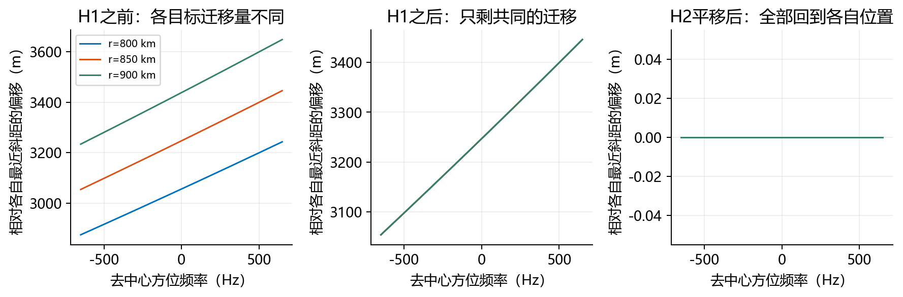

图5 每条曲线都减去了它自己的最近斜距。H1之后曲线重合表示迁移量一致，并不表示不同距离目标被压到了同一个位置；H2之后各自相对误差才变为零。

乘H1产生的剩余相位为：

$$
\boxed{C(r,f_a)=\pi K_m\frac a{1+a}(\tau_r-\tau_0)^2
=\pi K_ma(1+a)\left[\frac{2(r-r_0)}c\right]^2.}\tag{5.5}
$$

式（5.5）的第二个等号使用 $\tau_r-\tau_0=(1+a)2(r-r_0)/c$，平方产生 $(1+a)^2$，与分母约去一个。它不随快时间变化，却随目标距离和方位频率变化，因此以后还要补偿。

**本节交接：** H1已经把迁移改成共同偏移，但还没有真正压成窄脉冲。下一步进入二维频域，同时完成压缩和共同平移。

## 6. 第二个滤波器 H2：距离压缩加共同平移

### 6.1 新调频信号的频谱相位

将 $K'=K_m(1+a)$，$u=\tau-\tau_1$ 代入距离FFT积分。相位为 $\pi K'u^2-2\pi f_\tau(u+\tau_1)$。先提出延时因子，再按式（3.5）配方，得到相位部分：

$$
\mathcal F_\tau\{e^{j\pi K'(\tau-\tau_1)^2}\}
\ \propto\ e^{-j\pi f_\tau^2/K'}e^{-j2\pi f_\tau\tau_1}.
\tag{6.1}
$$

式（6.1）的比例号表示忽略公共幅度、常相位和缓变包络后的局部相位关系；有限孔径或有限脉冲不能无条件使用无限调频函数的积分代替。此处要抵消的二次相位分母是 $K'$，而不是原始 $K_r$。

### 6.2 用正的线性频率相位向前移动

根据式（3.3），延迟 $\Delta\tau$ 的因子是 $e^{-j2\pi f_\tau\Delta\tau}$。为了去掉已经存在的共同延迟，需要乘相反相位。因此设计：

$$
\boxed{\begin{aligned}
H_2(f_\tau,f_a)&=
\exp\left[j\frac{\pi f_\tau^2}{K_m(1+a)}\right]
\exp[j2\pi f_\tau\Delta\tau_0]\\
&=\exp\left[j\frac{\pi f_\tau^2}{K_m(1+a)}
+j\frac{4\pi r_0}c\left(\frac1D-1\right)f_\tau\right].
\end{aligned}}\tag{6.2}
$$

式（6.2）第一项抵消调频频谱的二次相位，将长距离脉冲压窄；第二项抵消参考迁移的线性频率相位，将所有目标一起提前 $\Delta\tau_0$。这个正号可以通过乘积直接检查：

$$
e^{-j2\pi f_\tau(2r/c+\Delta\tau_0)}
e^{+j2\pi f_\tau\Delta\tau_0}
=e^{-j2\pi f_\tau(2r/c)}.\tag{6.3}
$$

式（6.3）中两个共同延迟项一正一负相消，目标自己的 $2r/c$ 留下。若把第二个指数写成负号，共同迁移会加倍而不是消除。

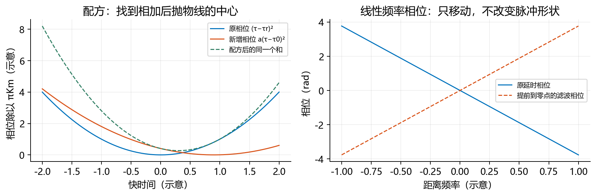

图6 配方只重写同一个多项式，没有修改相位的值；频域线性相位相乘则是实际滤波运算，会改变脉冲的位置。

### 6.3 距离 IFFT 后留下什么

将已经抵消的频率项去掉，剩余距离幅度谱的逆变换记为 $q$。距离IFFT后：

$$
S_3(\tau,f_a;r)\approx B_3\,q(\tau-2r/c;f_a)
e^{jC(r,f_a)}e^{-j4\pi f_crD/c}e^{-j2\pi f_a\eta_{\min}}.
\tag{6.4}
$$

式（6.4）的中心已是 $\tau=2r/c$，完成了RCMC。$q$ 保留距离压缩后的有限带宽形状，$B_3$ 吸收公共增益及缓变项。剩下的三个指数分别是H1新增的剩余相位、方位传播相位和目标的方位位置相位。它们决定最后一个滤波器。

**本节交接：** 距离对齐之后仍不能直接把各方位频率相加；只有先消除与频率相关的方位相位，点目标才会聚焦。

## 7. 第三个滤波器 H3：补剩余相位并完成方位聚焦

### 7.1 先解释为什么代码里用两个方位频率

参考多普勒中心是平台从波束中心看向参考目标时的瞬时频率。对式（2.1）求导，并在 $\eta=\eta_b$ 处代入：

$$
R'(\eta)=\frac{V^2(\eta-\eta_{\min})}{R(\eta)},\qquad
R'(\eta_b)=-V\sin\theta,\qquad
f_{dc}=\frac{2V_{\rm ref}\sin\theta}{\lambda}.\tag{7.1}
$$

式（7.1）的第二项使用 $\eta_b-\eta_{\min}=-r\tan\theta/V$ 和 $R_b=r/\cos\theta$，所以 $V^2(-r\tan\theta/V)/(r/\cos\theta)=-V\sin\theta$。传播相位 $-4\pi R/\lambda$ 对时间求导后除以 $2\pi$，得到 $f_D=-2R'/\lambda$，所以接近时多普勒为正。

代码在慢时间先乘 $e^{-j2\pi f_{dc}\eta}$。代入傅里叶定义可看到：

$$
\begin{aligned}
S_b(f_b)&=\int s(\eta)e^{-j2\pi f_{dc}\eta}e^{-j2\pi f_b\eta}d\eta
=S(f_b+f_{dc}),\\
\boxed{f_a=f_b+f_{dc}.}
\end{aligned}\tag{7.2}
$$

式（7.2）中 $f_b$ 在去中心FFT的 $[-\mathrm{PRF}/2,\mathrm{PRF}/2)$ 区间内，$f_a$ 才是代入 $D$ 与 $K_m$ 的真实频率。中心值超过PRF本身并不阻止已知中心的理想复基带仿真，但实际系统必须解决多普勒模糊数估计；本实验将它作为已知标定，不研究估计问题。

### 7.2 为什么不必补偿所有常量相位

成像需要对齐不同 $f_b$ 的相位。对单个目标，完全不随 $f_b$ 变化的相位只会旋转它的复系数，不会改变幅度聚焦。因此定义中心频率参考因子：

$$
D_c(r)=\sqrt{1-\left[\frac{cf_{dc}}{2f_cV_r(r)}\right]^2},\qquad
\delta(r)=\frac{r\tan\theta}{V_r(r)}=\eta_{\min}-\eta_b.
\tag{7.3}
$$

式（7.3）的 $D_c$ 固定于已去除的中心频率；$\delta$ 是最近时刻与波束中心时刻之差，单位s。方位匹配使用输出距离像素对应的 $V_r(r)$，不再把整个输出段的速度都替换为一个值。

最后的相位滤波器为：

$$
\boxed{\begin{aligned}
H_3(\tau,f_b)&=e^{-jC(r,f_a)}
e^{+j4\pi f_cr[D(r,f_a)-D_c(r)]/c}
e^{+j2\pi f_b\delta(r)},\\
r&=c\tau/2,\qquad f_a=f_b+f_{dc}.
\end{aligned}}\tag{7.4}
$$

式（7.4）第一项对消式（5.5）的剩余相位；第二项消除传播相位随方位频率的变化；第三项把方位坐标从最近时刻移回波束中心时刻。所有指数均为rad。这里 $C$ 仍使用当前段参考 $K_m,D,a,r_0$，第二、三项的速度则随输出距离更新。

### 7.3 把三个指数完整相乘检查

先对消 $C$，传播相位的乘积为：

$$
e^{-j4\pi f_crD/c}e^{+j4\pi f_cr(D-D_c)/c}
=e^{-j4\pi f_crD_c/c}.\tag{7.5}
$$

式（7.5）右侧与 $f_b$ 无关，可以作为目标常相位保留。位置相位则按 $f_a=f_b+f_{dc}$ 和 $\eta_{\min}=\eta_b+\delta$ 展开：

$$
\begin{aligned}
-2\pi f_a\eta_{\min}+2\pi f_b\delta
&=-2\pi(f_b+f_{dc})(\eta_b+\delta)+2\pi f_b\delta\\
&=-2\pi f_b\eta_b-2\pi f_{dc}(\eta_b+\delta)\\
&=-2\pi f_b\eta_b-2\pi f_{dc}\eta_{\min}.
\end{aligned}\tag{7.6}
$$

式（7.6）第二行把 $-2\pi f_b\delta$ 与 $+2\pi f_b\delta$ 相消。最终唯一的线性方位频率相位为 $-2\pi f_b\eta_b$；其余仍是单目标常相位。

### 7.4 最后一次 IFFT 为什么会得到一个点

若为解释主瓣而近似有效方位频谱为宽度 $B_a$ 的矩形，方位逆变换中的积分为：

$$
\begin{aligned}
\int_{-B_a/2}^{B_a/2} e^{j2\pi f_b(\eta-\eta_b)}df_b
&=\left.\frac{e^{j2\pi f_b(\eta-\eta_b)}}{j2\pi(\eta-\eta_b)}\right|_{-B_a/2}^{B_a/2}\\
&=\frac{\sin[\pi B_a(\eta-\eta_b)]}{\pi(\eta-\eta_b)}
=B_a\operatorname{sinc}[B_a(\eta-\eta_b)].
\end{aligned}\tag{7.7}
$$

式（7.7）使用 $e^{jx}-e^{-jx}=2j\sin x$；在 $\eta=\eta_b$ 处用极限 $\sin x/x\to1$，取值为 $B_a$。本文定义 $\operatorname{sinc}(x)=\sin(\pi x)/(\pi x)$。因此峰值位于 $\eta_b$。真实有限孔径频谱并不恰好是矩形，式（7.7）用于理解位置和主瓣量级，而不是代替实际原始回波成像。

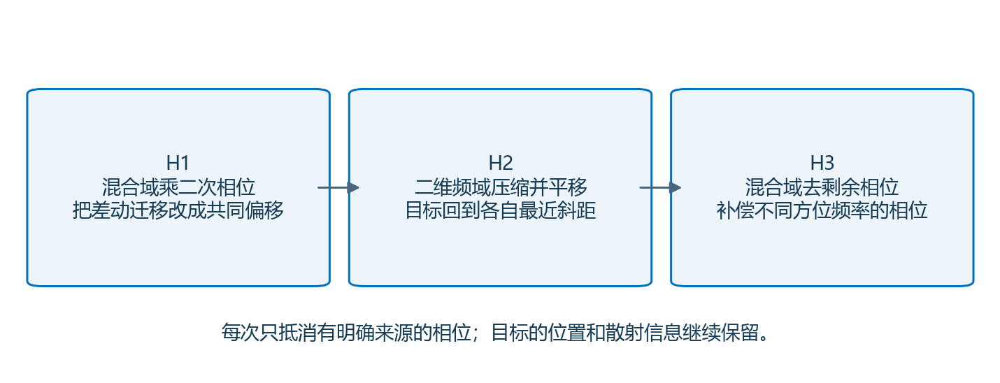

图7 H1改变后续距离压缩所见的调频相位；H2在二维频域压缩并移位；H3回到混合域后利用已对齐的距离坐标补方位相位。

### 7.5 一个会污染复数剖面的实现细节

若把H3写成 $e^{+j4\pi f_crD/c}e^{+j2\pi f_a\delta}$，在单目标的理想位置上也能抵消全部方位相位，但额外添加了随输出距离快速变化的常量相位。离散复数剖面可能被调制到不合适的频带，之后的复数插值会给出失真的主瓣和旁瓣。

本实现按式（7.4）仅补偿随 $f_b$ 变化的部分，保留式（7.5）、（7.6）的单目标常相位。这样既聚焦到 $\eta_b$，又避免人为添加不必要的距离相位斜坡。早期核验曾发现距离剖面异常；采用上述归一化后，重新处理同一原始数据，旁瓣与主瓣检查通过。这里说明的是可复核的相位约定，不代表所有相位约定都必须相同。

**本节交接：** 三相位流程已经闭合。下一步说明把它应用到距离空变速度时，哪些量应逐距离更新，哪些量只能局部近似。

## 8. 从一个参考距离到全距离带：怎样保留 Vr(r)

### 8.1 回波与处理分别使用什么速度

生成器对每个目标按真实模型参数 $r$ 查表得到 $V_r(r)$，孔径内保持不变。处理器不读取目标位置，而是读取随数据保存的距离—速度标定曲线。在H1、H2中，每个距离段使用本段参考 $r_0,V_r(r_0)$；在H3中，每一个输出距离像素按 $r=c\tau/2$ 更新速度。

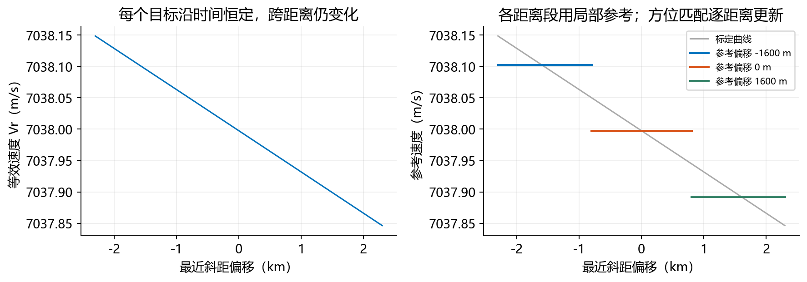

图8 正式输出范围为中心最近斜距±2300 m，三个参考中心偏移为−1600、0、1600 m。输出列归属最近的参考中心，核心段边界约为±800 m。

### 8.2 分段的残余迁移如何计算

设当前目标的真实因子是 $D_r$，处理段因子为 $D_0$。仍使用 $a_0=1/D_0-1$。暂时只研究中心位置，并保持同一个调频率近似，H1后的中心为：

$$
\begin{aligned}
\tau_1&=D_0\left[\frac{2r}{cD_r}+
\left(\frac1{D_0}-1\right)\frac{2r_0}{cD_0}\right],\\
\tau_{\rm out}&=\tau_1-\frac{2r_0}c\left(\frac1{D_0}-1\right)
=\frac{2r}c\frac{D_0}{D_r},\\
\boxed{\Delta r_{\rm tile}=r\left(\frac{D_0}{D_r}-1\right).}
\end{aligned}\tag{8.1}
$$

式（8.1）第一行乘开 $D_0$ 后，第一项为 $2rD_0/(cD_r)$，第二项为 $2r_0/c(1/D_0-1)$。第二项与H2的共同移位完整相消。最终从 $c\tau_{\rm out}/2$ 减去真实 $r$，得到第三行。它只估计参考速度不一致带来的中心残差，不包含调频率不一致、有限孔径或高阶频谱截断。

### 8.3 本实验的分段误差有多大

在输出距离±2300 m、$f_b\in[-850,850]$ Hz、$f_\tau\in[-B/2,B/2]$ 的离散网格上，检查结果为：

| 检查对象 | 网格最大值 | 含义 |
|---|---:|---|
| 式（8.1）的距离分段残余 | 约0.053 m | 只考虑D的参考速度误差 |
| 冻结 $K_m$ 的二次相位差 | 约0.00161 rad | 用 $\pi f_\tau^2\lvert1/K_m(r)-1/K_m(r_0)\rvert$ 评估 |
| 平方根频谱二阶截断相位差 | 约0.00249 rad | 用前文完整平方根减二阶展开后乘 $4\pi r/c$ |

这些是所列网格上的最大值，不是连续域的严格上界，也不覆盖模型、有限孔径和采样误差。三距离目标的速度分别约7038.096、7037.998、7037.899 m/s，变化很小。因此本实验的成功不能证明距离分段相对全场景单参考有显著性能优势；分段是为了保留一般化的 $V_r(r)$ 接口，并使误差可计算。

### 8.4 拼接是不是在偷偷做 RCMC 插值

不是。所有距离段都选择 $D_{\rm ref}=1$，采用相同原始快时间网格，因此输出最近斜距均为 $c\tau/2$。各段处理完整输入，只保存其拥有的核心列，直接拼接复数列，不对距离轴重采样。RCMC本身由相位相乘、FFT和IFFT完成。

代码中的 `interp1` 只查询已知速度标定表；公共指标函数里的 `interpft` 只用于成像完成后的剖面测量，二者都不参与回波的RCMC取样。硬分段可能留下复数相位或增益接缝；本实验目标不在分段边界上，不能据此证明连续分布场景的接缝误差可忽略。更宽距离带应检查重叠融合或非线性CS。

**本节交接：** 公式已经对应到可实现的局部滤波器。下面给出实际参数、数组坐标、运行方式及实验结果。

## 9. MATLAB 实现：生成、处理、评价各自独立

### 9.1 常用星载参数的来源与教学改动

| 参数 | 本实验数值 | 来源或选择理由 |
|---|---:|---|
| 载频 $f_c$ | 5.3 GHz | ESA公开ERS量级参数 |
| 带宽 $B$ | 15.50829 MHz | ISCE2 `ERS.py` 的公开常量 |
| 快时间采样率 $F_s$ | 18.962468 MHz | 同一开源传感器文件 |
| 脉宽 $T_p$ | 37.1 μs | NASA ASF手册交叉核对微秒单位 |
| PRF | 1700 Hz | 教学选择，非某份ERS产品元数据 |
| 轨道高度 | 785 km | ESA公开量级 |
| 中心最近斜距 | 850 km | 教学场景设置 |
| 斜视角 | 5° | 教学设置，不声称ERS按此角度工作 |
| 有效照射时间 | 0.6 s | 缩短的矩形教学孔径，不模拟完整真实天线方向图 |
| 原始矩阵 | 2048×4096复数single | 行慢时间，列快时间 |
| 九点场景 | 距离偏移−1500、0、1500 m；$\eta_b$=−0.08、0、0.08 s | 两组三值做笛卡尔积 |

参考速度约7038.0 m/s，真实多普勒中心约21688.54 Hz。输出方位坐标采用 $x_*=V_{\rm ref}\eta_b$，九点在该轴约为−563.04、0、563.04 m。它是一条明确的方位标度，不是经过地理编码的地面直角坐标。输出距离是最近斜距，不是地距。

ISCE2版本固定为 `b7702cfbd571681a133ebc5c3b23a10c78d52706`；只参考公开参数，未复制其处理算法。ESA入门网页将37.12对应脉宽单位误写成msec，而同时给出约704个18.96 MHz采样点；704/18.96 MHz约37.1 μs，本文采用NASA资料核对后的微秒值。

### 9.2 文件对应关系

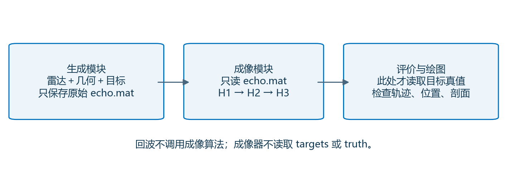

图9 保存的原始数据只读传入成像器，不被改写。生成器不知道H1/H2/H3是什么，处理器也不知道目标列表。

| 文件，相对项目根目录 | 作用 |
|---|---|
| `echo_generation/configs/spaceborne_cs_teaching.m` | 集中定义雷达、几何、目标、采样和来源 |
| `echo_generation/geometry/spaceborne_equivalent_geometry.m` | 生成速度标定曲线和轨道示意 |
| `echo_generation/targets/spaceborne_cs_targets.m` | 生成目标的最近斜距与波束中心时刻 |
| `echo_generation/generate_spaceborne_cs_echo.m` | 只按式（3.1）叠加原始回波 |
| `signal_processing/cs/spaceborne_cs_options.m` | 独立的CS分段、输出、分块参数 |
| `signal_processing/cs/run_spaceborne_cs.m` | 式（5.1）、（6.2）、（7.4）对应的核心实现 |
| `experiments/exp_003_spaceborne_cs_teaching/run_generation.m` | 只生成并保存两份原始回波 |
| `experiments/exp_003_spaceborne_cs_teaching/run_imaging.m` | 只读已有回波、处理并保存结果 |
| `experiments/exp_003_spaceborne_cs_teaching/run_all.m` | 方便依次调用两个独立入口 |
| `experiments/exp_003_spaceborne_cs_teaching/evaluate_cs_teaching.m` | 用公共指标评价所有目标和RCM轨迹 |
| `experiments/exp_003_spaceborne_cs_teaching/render_cs_teaching.m` | 用公共中文样式绘制实际结果 |

上述11个MATLAB文件共395行非空可执行代码，每行均有中文注释；结构控制行和函数声明也有注释。注释解释坐标、单位、关键假设、相位用途与边界。旧公共函数保持原样复用；本文不声称为整个历史项目的所有代码补齐了逐行注释。

### 9.3 各阶段数组的坐标和尺寸

| 阶段 | 行坐标 | 列坐标 | 本次数组尺寸 |
|---|---|---|---|
| 原始回波 | $\eta$，s | $\tau$，s | 2048×4096 |
| 去中心、双边补零、方位FFT | $f_b$，Hz | $\tau$，s | 4096×4096 |
| H1之后距离FFT | $f_b$，Hz | $f_\tau$，Hz | 4096×4096 |
| H2之后距离IFFT | $f_b$，Hz | $r=c\tau/2$，m | 4096×4096 |
| H3之后方位IFFT并裁取 | $x_*=V_{\rm ref}\eta_b$，m | 最近斜距 $r$，m | 483×581 |

FFT使用 `fftshift(fft(ifftshift(...)))`，逆变换同样先将中心移回数组首部。MATLAB默认FFT无归一化，IFFT含 $1/N$；这影响统一增益，不改变滤波相位。快时间FFT内部以记录中心为零，等价于统一移去绝对时间原点产生的线性频率因子；同一数据上的正逆变换一致使用该原点，而H1中的传播时延仍使用绝对 $\tau$。

### 9.4 独立运行方式

在MATLAB中先添加实验入口目录：

```matlab
addpath('D:/sar_project/experiments/exp_003_spaceborne_cs_teaching'); % 添加本实验入口。
paths = run_generation(); % 只生成单点和九点原始回波，返回两条文件路径。
summary = run_imaging(paths); % 只读取刚才保存的原始数据并执行CS成像。
```

也可以关闭MATLAB后再读取已有文件，不必重新生成：

```matlab
addpath('D:/sar_project/experiments/exp_003_spaceborne_cs_teaching'); % 添加入口；不依赖当前工作目录。
summary = run_imaging('D:/sar_project/data/simulated/echo_003_spaceborne_cs_single_20261104_223344_762/echo.mat'); % 只处理已保存的中心单点原始回波。
```

便捷的一次运行入口是 `summary=run_all();`，它仍通过两个独立函数完成任务。每次运行创建新的编号，不覆盖已有原始数据或正式结果。本次实际用MATLAB R2022b运行，代码遵循R2021b语法范围；没有宣称已在R2021b安装上实测。

### 9.5 几个容易使正确公式失效的实现选择

1. **先去中心，再计算真实频率。** FFT轴是 $f_b$，根号和调频率必须使用 $f_b+f_{dc}$。
2. **先H1，再距离FFT。** H1是快时间二次相位，不能直接把同一表达式乘到距离频率轴上。
3. **H2中的线性项用正号。** 式（6.3）已经逐项检查了提前移位的符号。
4. **H3里的剩余相位用负号。** 它抵消H1产生的 $+C$。
5. **相位先以double计算，再转换single保存乘法因子。** 约850 km斜距的载频传播相位很大，过早用single计算会损失相位精度。
6. **采集窗和补零不是同一件事。** 生成时检查脉冲支持和照射支持均在原始窗口内；方位双边补零减小循环处理卷绕，不能补回已经截断的真实回波。
7. **分块不是近似。** 每块64个方位频率只控制内存；相同位置的滤波公式不改变。

**本节交接：** 代码能够运行只是第一层检查。还需要从同一个目标的轨迹、位置和点响应，验证它做对了什么。

## 10. 实验结果：先查 RCM，再查九点位置与聚焦

### 10.1 校正前后测的是同一个单点

单点诊断先对原始方位频谱做普通距离压缩，得到尚未校正的轨迹；正式CS在H2后得到已校正轨迹。评价只使用实际照射频带中部 $\lvert f_b\rvert\le0.4B_a$，避开有限孔径端点的明显影响。

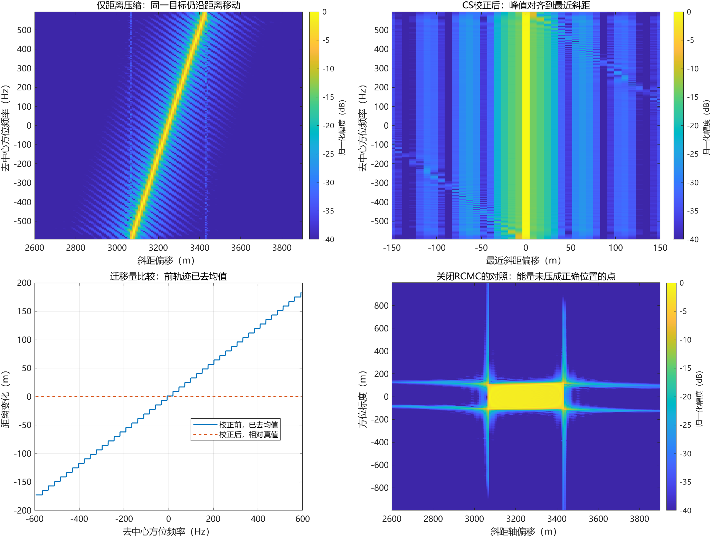

图10 上左的亮线随方位频率移动，上右亮线对齐在零距离偏移。下右是在同一份原始回波上关闭RCMC、只做普通距离压缩和方位相位处理的对照；它同时未使用正式CS中的几何二次距离补偿，所以用于展示“缺少RCMC/SRC联合处理”的失败，不能据此单独分离两项校正各自的贡献。

| 中心单点指标 | 实测结果 |
|---|---:|
| RCM校正前峰值轨迹跨度 | 295.680 m |
| RCM校正后峰值轨迹跨度 | 0.0768 m |
| 校正后轨迹偏离最近斜距的最大值 | 0.0430 m |
| 距离主瓣半功率宽度 | 8.5319 m |
| 方位主瓣半功率宽度 | 5.0907 m |
| 距离峰值旁瓣比 | −13.253 dB |
| 方位峰值旁瓣比 | −13.344 dB |
| CS相对关闭联合校正对照的峰值幅度增益 | 30.02 dB |

轨迹的亚采样位置由三个峰值邻点的对数幅度抛物线估计。它比原始约7.90 m距离采样间隔更细，表示理想无噪声模型下的估计值，并不意味着实际距离分辨率为0.04 m。直接整数峰轨迹呈阶梯形也来自有限采样，而非距离真实跳变。

### 10.2 九点能否都回到正确位置

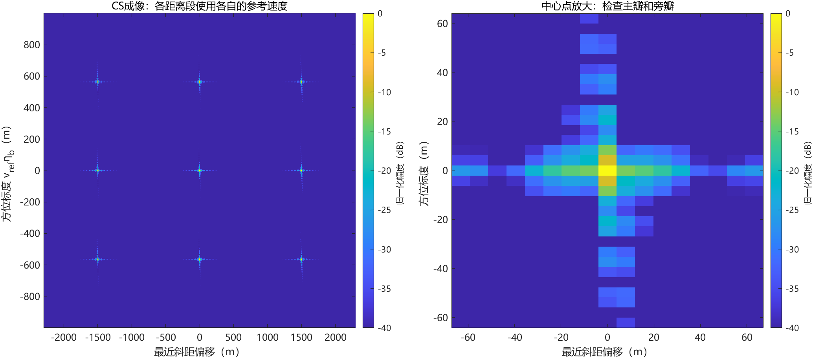

图11 九个目标分布在三个距离和三个波束中心时刻。每个目标单独在局部窗内测量，不只评价全图最高峰。九点最大距离峰值误差约0.0471 m；三个方位真值恰落在本次采样网格上，插值峰值落于这些位置，所以记录的最大方位误差为0。这不能解释为一般场景下的零定位误差。

| 九点汇总 | 实测范围或最大值 |
|---|---:|
| 距离半功率主瓣宽度 | 8.5311～8.5326 m |
| 方位半功率主瓣宽度 | 5.0814～5.1017 m |
| 最大距离峰值误差 | 0.0471 m |
| 最大方位标度误差 | 本采样对齐场景中为0 m |
| 所有九点的预设检查 | 通过 |

### 10.3 主瓣、旁瓣这些词怎样对应图上的量

主瓣是目标峰值附近最主要的峰；旁瓣是两侧较小的振荡。峰值旁瓣比PSLR用最大旁瓣功率除以峰值功率，再取 $10\log_{10}$，越负代表最大旁瓣越弱。ISLR用所选窗口内主瓣外总能量除以主瓣内能量，再取对数。

公共评价函数先对**复数剖面**用32倍 `interpft` 插值，再取幅度；不能先取绝对值再插值，因为那样会丢失相位对峰形的影响。主瓣边界取峰值两侧第一个局部极小值，ISLR只在记录的约±110 m剖面窗内积分。

$$
\boxed{\mathrm{PSLR}=10\log_{10}\frac{\max_{\rm sidelobe}|I|^2}{|I_{\rm peak}|^2},\qquad
\mathrm{ISLR}=10\log_{10}\frac{\int_{\rm sidelobe}|I|^2 dx}{\int_{\rm mainlobe}|I|^2 dx}.}\tag{10.1}
$$

式（10.1）的积分和最大值范围由上一段给定，不是无限场景上的能量。相同幅度比也可使用 $20\log_{10}$，因为功率是幅度平方；这是对数法则 $\log a^2=2\log a$ 的直接结果。

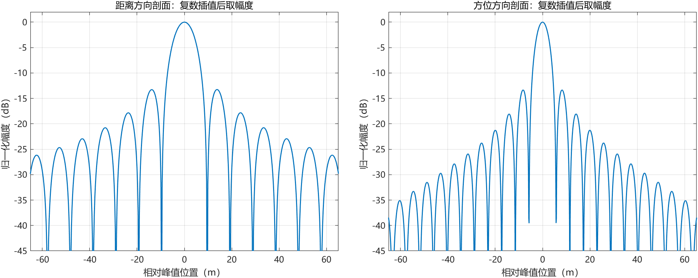

图12 −3.0103 dB对应功率为峰值的一半，因为 $10\log_{10}(1/2)\approx-3.0103$。两个半功率交点间距离就是本文的主瓣宽度。

对理想矩形频带，式（7.7）的功率形状为 $\operatorname{sinc}^2(Bx)$。半功率位置满足 $[\sin(\pi z)/(\pi z)]^2=1/2$，数值根为 $z\approx\pm0.443$，两根间距约0.886。因此用于量级对照的宽度为：

$$
\Delta r_{3\rm dB}\approx0.886\frac{c}{2B},\qquad
\Delta x_{*,3\rm dB}\approx0.886\frac{V_{\rm ref}}{B_a}.\tag{10.2}
$$

式（10.2）不是把距离采样间隔当分辨率。距离时间宽度 $0.886/B$ 乘 $c/2$ 变为m；方位时间宽度 $0.886/B_a$ 乘 $V_{\rm ref}$ 变为m。本次中心点参考值分别约8.564 m、5.102 m，实测与之接近。

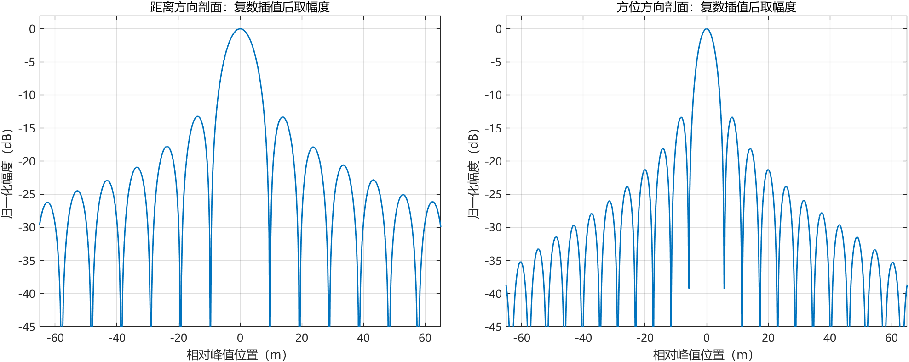

图13 无加窗的矩形有效孔径本来就会出现约−13 dB量级的第一旁瓣；它不表示CS失效。若为了压低旁瓣增加窗函数，应同时报告主瓣变宽，不能只展示旁瓣改善。

### 10.4 判据在结果之前已经写进评价器

本实验要求每个目标位置误差小于一个对应采样间隔，距离及方位主瓣宽度相对矩形频带参考的偏差小于25%，两方向PSLR低于−10 dB。单点另外要求校正前迁移超过50 m，校正后跨度和偏差均小于5 m。判据用于本教学参数，不是行业通用性能标准。

所有指标及失败标记都保存。最初未通过的运行也保留在本地独立编号目录中；正式结果采用通过全部检查的 `run_20261104_223510_663`，没有覆盖或抹掉先前结果。

**本节交接：** 这些结果证明了本参数下的距离对齐和点目标聚焦。最后需要把这一结论与模型、近似和实际应用范围分开。

## 11. 哪些结论成立，哪些问题仍须进一步验证


图14 几何误差是“模型距离与真实距离不同”；频谱误差是“用有限阶近似代替完整积分”；数值误差是“有限数组实现连续公式”。本实验验证的是给定等效几何、采样和参数下的CS流程。

本文能够确认：三个滤波器的配方和平移符号一致；中心单点的RCM明显减小；三个距离处的九点均被聚焦并定位到预期的最近斜距和方位标度；处理器没有读取目标真值，也没有用插值代替CS的RCMC。

本文尚未验证：真实卫星原始数据；地球自转、椭球、运动目标、停走误差；完整真实天线照射；大斜视和超宽带；强速度空变条件；连续分布场景的分段接缝；多普勒中心及速度标定存在误差时的鲁棒性。5°结果不能直接外推到45°，也不能因为频谱起点有完整平方根，就忽略式（4.3）的二阶截断。

若进一步增大斜视或带宽，先用前文的完整平方根计算二阶余项，再看目标有效频带内的误差。若余项明显影响相干累加，应考虑更高阶CS、非线性CS、分子带处理或保留完整几何的成像方法，而不是仅调整图像色标。

## 12. 核心公式索引与复现证据

| 公式 | 经常使用的内容 | 使用位置 |
|---|---|---|
| （2.1） | 距离历程、两种中心时刻 | 回波生成、坐标解释 |
| （2.4） | 距离空变速度标定 | 几何模块、CS速度查询 |
| （3.1） | 原始复基带回波 | 独立生成器 |
| （3.4） | 距离频域—方位时域表达式 | 衔接几何和频谱 |
| （4.1） | 保留平方根的驻相频谱 | CS展开的起点 |
| （4.5） | 距离调频率 $K_m$ | H1、H2、剩余相位 |
| （5.1）、（5.4） | H1与共同迁移偏移 | 混合域缩放 |
| （5.5） | 剩余相位 $C$ | H3中抵消 |
| （6.2） | H2 | 压缩距离并校正共同RCM |
| （7.2）、（7.4） | 真实频率和H3 | 方位压缩及时间原点变换 |
| （8.1） | 分段参考速度的迁移残差 | 误差诊断 |

正式原始回波位于项目 `data/simulated/`：中心单点编号 `echo_003_spaceborne_cs_single_20261104_223344_762`，九点编号 `echo_003_spaceborne_cs_nine_20261104_223344_762`。两份文件均名为 `echo.mat`，含原始矩阵、快慢时间、雷达参数、几何标定、目标真值、处理状态、完整配置与生成版本。

正式图像及完整复数结果位于 `results/exp_003_spaceborne_cs_teaching/run_20261104_223510_663/cs/`。可提交的逐点指标与配置记录位于 `experiments/exp_003_spaceborne_cs_teaching/records/run_20261104_223510_663/`。`filter_checks.json` 记录符号恒等式、距离分段残差与逐行注释检查。数据和MAT文件只保存在本地，不上传GitHub。

本文Markdown是唯一正文源；PDF由同一正文和同一组图片生成。导出程序检查数学式是否渲染、全部图片是否成功载入，并核对PDF正文、公式编号、页面边界及源文件SHA256；同时人工查看最终页面图。

## 13. 术语速查与参考资料

### 13.1 本文常用词的直白解释

| 词语 | 在本文中的意思 |
|---|---|
| 相干相加 | 保留复数相位相加，使同一目标的贡献互相加强 |
| 频谱 | 把信号按振荡频率分开后的复数记录 |
| 混合域 | 一个坐标仍是时间、另一个已换成频率；需明确是哪一个 |
| 驻相近似 | 振荡积分主要由相位变化很慢的局部区间贡献；有限端点仍可能有影响 |
| 泰勒展开 | 用函数值、斜率、弯曲程度等逐项构造局部多项式 |
| 二次相位 | 相位中含自变量平方；调频信号的常见形式 |
| 共轭 | 将复数虚部变号；单位相位 $e^{j\phi}$ 的共轭为 $e^{-j\phi}$ |
| 匹配滤波 | 用已知波形的相反频谱相位，让同一目标的贡献对齐 |
| RCM与RCMC | 距离峰值随观测过程移动；补偿这种移动 |
| SRC | 几何关联额外产生的距离二次频率相位补偿，不等于普通发射脉冲匹配 |
| 距离空变 | 参数因目标距离不同而不同，不表示同一目标随时间变化 |
| 相位滤波器 | 乘一个模长为1的复数，在不直接改采样坐标的情况下改变相位 |
| 消融对照 | 关闭一部分处理，用相同输入观察差别，并明确同时关闭了哪些项 |

### 13.2 来源及证据范围

1. [前一份项目推导：星载斜视SAR变等效速度精确频谱推导](../spaceborne_squint_variable_vr/星载斜视SAR变等效速度精确频谱推导.md)。本文式（3.4）、（4.1）和频谱展开分别对应其距离频域表达、驻相相位与第9节二阶耦合分析；前文关于有限孔径与精确积分的边界继续适用。
2. [ISCE2 ERS传感器公开实现，固定版本](https://github.com/isce-framework/isce2/blob/b7702cfbd571681a133ebc5c3b23a10c78d52706/components/isceobj/Sensor/ERS.py)。已核对源文件中的带宽15.50829 MHz、采样率18.962468 MHz及调频率由带宽/脉宽计算的方式；本文没有复用其SAR成像代码。
3. [ESA：Introduction to a SAR System](https://www.esa.int/Enabling_Support/Space_Engineering_Technology/Onboard_Data_Processing/Introduction_to_a_SAR_System)。用于ERS载频、高度的量级参考；脉宽单位按本文第9节另作核对。
4. [NASA ASF：SAR User Guide](https://www.earthdata.nasa.gov/s3fs-public/2024-06/sci-sar-userguide.pdf)。用于交叉核对ERS量级脉宽37.1 μs；未将手册参数当作本实验的真实采集元数据。
5. [Raney等：Precision SAR Processing Using Chirp Scaling，DOI 10.1109/36.298008](https://doi.org/10.1109/36.298008)，1994；[DLR公开书目信息](https://elib.dlr.de/205/)。用于CS方法出处。本文滤波公式按当前符号从项目已有频谱逐项推导，未将书目页面视为全文公式核验。

本次参数来源于2026年11月4日核对；正式成像数值来自本机MATLAB运行，而非文献图片或Python替代结果。
