# 星载斜视 SAR 回波频谱推导：图解入门与严谨推导

**距离时间 $\tau$，方位时间 $\eta$；单目标孔径内 $V_r(r)$ 不变，不同距离目标仍采用不同速度。**

**时间原点：** 对本次讨论的单目标或参考目标，取波束中心时刻为 $\eta=0$；最近斜距时刻记为 $\eta_{\min}$。修订日期：2026 年 11 月 4 日。

## 1. 从几何到频谱：先建立阅读主线

本教材面向刚开始研究 SAR 的研究生。阅读时先抓住一条因果链：平台运动改变斜距，斜距改变回波的到达时间和相位；对回波作傅里叶变换，就得到不同表示域；最后才讨论怎样用近似计算频谱、怎样校正距离徙动和相位误差。

**斜距**是雷达到目标的单程直线距离。**合成孔径**指把平台运动期间许多脉冲的回波一起相干处理，获得虚拟长天线的分辨能力；本文的孔径区间 $I$ 指当前目标参与积累的那段方位时间。

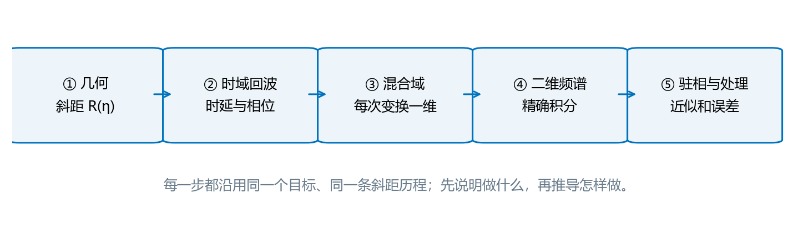

图 1　从几何到频谱的阅读路线。先读第 2 至 10 节主线；第 11 节检查算例，第 12 节选择精度。附录保留较难的推导，第一次阅读可跳过。

### 1.1 本文要回答的三个问题

第一个问题是“同一个目标在不同脉冲中离卫星多远”，答案是斜距函数 $R(\eta)$。第二个问题是“这个距离怎样出现在信号里”，答案是时延 $2R/c$ 和传播相位 $-4\pi f_cR/c$。第三个问题是“频域算法实际使用哪一部分信息”，答案需要同时保留脉冲频谱、几何相位、幅度与有效孔径。

本版固定约定：距离时间为 $\tau$、方位时间为 $\eta$；等效速度写成 $V_r(r)$，对单目标的孔径内时间不变，对不同距离目标仍然变化。针对正在推导的单目标或场景参考目标，取**波束中心经过目标的时刻为 $\eta=0$**；最近斜距时刻另记为 $\eta_{\min}$。第 3 节先把这两个时刻讲清楚。

### 1.2 先读懂复数相位，再读积分

SAR 保存幅度和相位，常用一个复数表示。它可看成一支箭头：长度为幅度 $A$，方向角为相位 $\phi$。数学写法是：

$$
z=Ae^{j\phi}=A\cos\phi+jA\sin\phi,\qquad j^2=-1.
\tag{1.1}
$$

式（1.1）中的实部和虚部分别是箭头在两条坐标轴上的投影；$\phi$ 用 rad 表示，$A$ 的单位沿用所描述的信号。复指数不表示信号能量随相位增大而增长，它只记录箭头旋转。

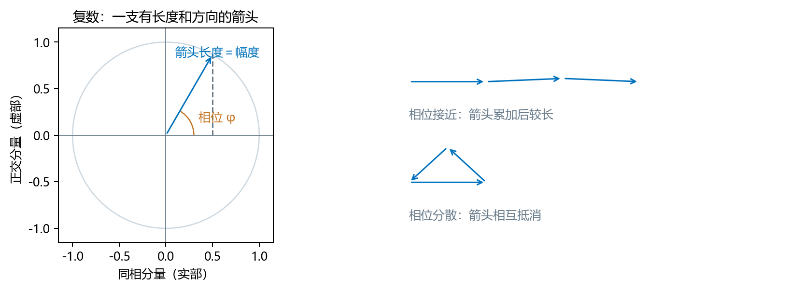

图 2　复数与相干相加。把许多复数相加时，方向相近会积累，方向分散会抵消；后面的方位积分就是连续地做这种相加。

**读符号的小规则。** $|z|$ 是箭头长度；$z^*$ 是复共轭，即虚部变号、相位反号；$zz^*=|z|^2$。积分 $\int$ 是把连续分布的许多小贡献相加；导数 $dR/d\eta$ 是距离曲线对时间的局部斜率。$=$ 表示在所声明模型内相等，$\approx$ 表示额外使用了近似。后文每次近似都会说明删去了什么。

### 1.3 如何使用框内公式与插图

框内公式是后面反复调用的关系。第一次遇到时，请同时记录它的输入、输出和成立条件；不要只抄等号右侧。插图紧跟相应公式或概念：几何图解释“变量代表什么”，曲线图解释“改变变量会发生什么”。完整公式索引与术语速查表放在文末，严格收敛和迟滞传播等内容放在附录。

## 2. 先认清坐标：同一个回波的四种表示

对本次推导的单目标或参考目标，慢时间原点 $\eta=0$ 取波束中心经过该目标的时刻；最近距离时刻通常不是零。$\tau$ 从对应脉冲的发射参考时刻计时。主体采用单站、单次散射、相干复基带、停走传播模型。

这里**单站**表示发射和接收共用同一平台；**单次散射**表示电波在目标处反射一次后返回；**停走近似**表示计算一发一收时先冻结平台位置，下一脉冲再更新。**复基带**表示先移去快速振荡的载频，再用复数保存剩余幅度和相位；**无色散**表示所建模频带内各频率使用同一个传播速度 $c$。这些是假设条件，附录 D 再讨论放宽停走时要改哪些式子。

| 符号 | 含义 | 单位和说明 |
| --- | --- | --- |
| $r$ | 等效双曲模型中的目标最近斜距，作为目标距离标签 | m；不是快时间采样下标，也不是瞬时斜距 |
| $\eta_{\min}$ | 同一目标在该模型中的最近距离时刻 | s；是目标的方位位置参数 |
| $R(\eta;r,\eta_{\min})$ | 该目标在等效模型中的单程瞬时斜距 | m |
| $R_{\mathrm{true}}(\eta;\boldsymbol p)$ | 给定真实轨道模型的矢量斜距 | m；与 $R$ 区别使用 |
| $R_b,u_0$ | 波束中心的 $R(0)$ 与 $-R'(0)$ | m、m/s；接近速度取正 |
| $V_r(r)$ | 每个目标孔径内固定、不同距离间变化的等效速度 | m/s；不自动等于卫星速度模 |
| $\theta$ | 参考时刻的有效斜视角，规定接近时取正 | rad；不自动等于真实几何斜视角 |
| $f_c,c,\lambda$ | 载频、真空光速和载频波长 | Hz、m/s、m；$\lambda=c/f_c$ |
| $K_r,T_p$ | 距离线性调频率和脉冲宽度 | Hz/s、s |
| $f_\tau,f_\eta$ | 距离频率和方位频率 | Hz；均为带符号基带频率 |
| $\sigma,a(\eta)$ | 目标复散射系数与孔径复幅度权 | 可包含天线、传播幅度和孔径窗 |
| $I=[\eta_a,\eta_b]$ | 有限有效孔径 | s |

同一全场景共用时间轴时，其他目标的波束中心时刻可以不是零；最近距离时刻仍各自独立。为使单点推导简洁，固定目标后会省略 $r,\eta_{\min}$ 的显式自变量。正向傅里叶变换采用负指数：

$$
S(f_\tau,f_\eta;r,\eta_{\min})
=\int_I\int_{\mathbb R}s(\tau,\eta;r,\eta_{\min})
e^{-j2\pi f_\tau\tau}e^{-j2\pi f_\eta\eta}
\,d\tau\,d\eta.
\tag{2.1}
$$

式（2.1）定义目标的二维频谱。$j^2=-1$；每个指数均无量纲。快时间全轴积分表示回波脉冲被完整接收；若接收门截断脉冲，需要把门函数纳入回波，不能直接使用后文完整脉冲的平移公式。

### 2.1 四种表示域及各自的变换变量

**傅里叶变换**可以理解为用不同频率的旋转箭头检查信号中各频率的复幅度；只变换一个自变量，另一个自变量仍保留原来的含义。为区分两种混合域，统一使用以下命名。$\mathcal F_\tau$ 表示只对快时间作正向变换，$\mathcal F_\eta$ 表示只对慢时间作正向变换；二者均采用式（2.1）的负指数约定。

| 表示域 | 自变量 | 记号 | 由原始回波得到它的操作 |
| --- | --- | --- | --- |
| 距离时域—方位时域 | $(\tau,\eta)$ | $s(\tau,\eta)$ | 原始复基带回波 |
| 距离频域—方位时域 | $(f_\tau,\eta)$ | $S_r(f_\tau,\eta)$ | 只作 $\mathcal F_\tau$，见第 5 节 |
| 距离时域—方位多普勒域，简称距离多普勒域 | $(\tau,f_\eta)$ | $S_{\mathrm{RD}}(\tau,f_\eta)$ | 只作 $\mathcal F_\eta$，见第 6.1 节 |
| 二维频域 | $(f_\tau,f_\eta)$ | $S(f_\tau,f_\eta)$ | 对快、慢时间均作正向变换 |

表中四种表示首先对应未作距离匹配滤波的同一回波。对发射波形作距离匹配滤波后，用上标 $\mathrm{rc}$ 标识；距离压缩改变信号，但不改变该表示域的自变量。以下分别给出原始回波与距离压缩后的表达式，防止把处理步骤隐含在域名称之中。

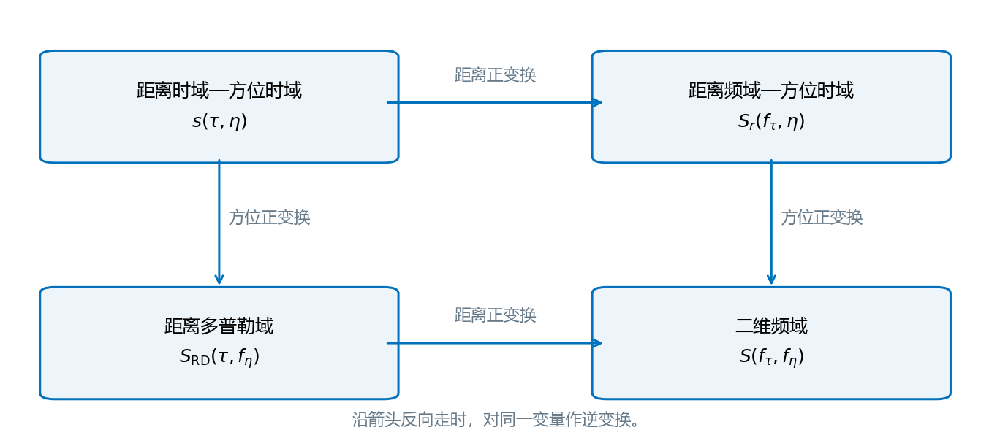

图 3　四种表示域。横向只变换距离时间，纵向只变换方位时间；图中每个框代表同一回波的不同数学表示。

**本节交接：** 现在知道时间和频率坐标怎样命名。接下来先建立 $R(\eta)$，再把它放进回波；暂时不需要做任何频谱近似。

## 3. 几何模型：波束中心、最近距离与距离空变速度

**本节输入：** 目标位置、参考斜距和等效速度。**本节输出：** 后面所有信号公式共用的斜距函数。

本次修订中的“$V_r$ 是变量”指**目标距离之间的空间变化**，而非同一目标的时间变化。以目标的模型最近斜距 $r$ 为距离标签，用 $V_r(r)$ 表示等效速度函数。对固定目标沿合成孔径求时间导数时，$r$ 和 $V_r(r)$ 均保持不变；跨距离目标比较或求距离偏导时，必须保留 $V_r(r)$ 的变化。

$$
\boxed{\left.\frac{\partial V_r(r)}{\partial\eta}\right|_r=0,
\qquad \frac{dV_r(r)}{dr}\ \text{一般不为零}.}\tag{3.1}
$$

式（3.1）左侧表达用户采用的孔径内时不变近似，右侧表达距离空变，单位分别为 m/s² 和 s$^{-1}$。前者是针对一个目标的时间演化，后者是针对不同目标的参数比较，不能互相替代。下文不再引入同一目标的 $V_r'(\eta)$、$V_r''(\eta)$ 项。

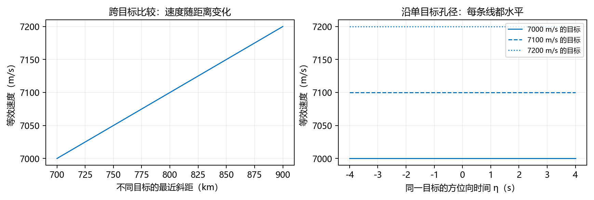

图 4　同一目标的速度在时间上固定，不同距离目标的速度不同。两个横轴代表不同问题，求导时不能混用。

### 3.1 先说明等效模型，再说明参数从哪里来

真实轨道的矢量计算放在附录 A。这里取波束中心时刻的参考值 $R_b=R_{\mathrm{true}}(0)$、$u_0=-R'_{\mathrm{true}}(0)$，构造与真实斜距在参考点匹配到二阶的双曲模型。“匹配到二阶”是指参考点的距离、一阶时间导数和二阶时间导数相同，不保证整个孔径内都完全相同：

$$
R^2(\eta)=R_b^2-2R_bu_0\eta+V^2\eta^2,
\qquad V=V_r(r)>0.
\tag{3.2}
$$

式（3.2）的 $V$ 是对该目标固定的数值，但不同 $r$ 可取不同值。将 $Q=R^2$ 求两次导数：$Q''=2[(R')^2+RR'']=2V^2$，再在原点匹配真实二阶导数，得到：

$$
V^2=[R'_{\mathrm{true}}(0)]^2
+R_bR''_{\mathrm{true}}(0)
=\|\boldsymbol v(0)\|^2+\boldsymbol\rho(0)\cdot\boldsymbol a_g(0).
\tag{3.3}
$$

式（3.3）的粗体 $\boldsymbol\rho$ 是目标指向平台的位置向量（m），$\boldsymbol v$ 是相对速度（m/s），$\boldsymbol a_g$ 是相对加速度（m/s²）；点号表示向量点积，双竖线表示向量长度。最后一个等号使用式（A.4），径向速度平方项相消。等效速度因此包含加速度的影响，不能直接拿卫星速度模替换它。若目前已有给定的等效速度，可先沿式（3.2）继续，待需要从星历求参数时再读附录 A。实际也可用整个孔径的斜距平方拟合求参数，但应记录方法与残差。

仅把 $V_r$ 近似为孔径内常数，不能逻辑上保证真实 $R_{\mathrm{true}}^2$ 恰为二次式。式（3.2）是另一个明确的等效几何假设；下文的闭式驻相结果以它为基础。若保留曲轨高阶残差，应使用第 6 节的真实距离积分，而不是把该残差强行解释成时间变化的 $V_r$。

### 3.2 波束中心为零，为什么最近距离仍在另一个时刻

现在明确 $R_b=R(0)$ 是波束中心斜距，令有效斜视角为 $\theta$。它由 $u_0=V\sin\theta$ 定义，不无条件等于真实轨道的几何角。把它代入式（3.2）得到：

$$
\boxed{R(\eta)=\sqrt{R_b^2-2R_bV\sin\theta\,\eta+V^2\eta^2}.}
\tag{3.4}
$$

式（3.4）的一次项保留了斜视的距离走动：前斜视 $\theta>0$ 时，波束中心时刻平台仍在接近目标。为了找到距离最小值，下面把平方根内部整理成“常数加一个平方”，这一代数操作叫**配方**。

设 $|u_0|<V$，定义有效斜视角 $\sin\theta=u_0/V$。将式（3.2）逐项配方：

$$
\begin{aligned}
R^2(\eta)
&=V^2\left(\eta-\frac{R_bu_0}{V^2}\right)^2
+R_b^2\left(1-\frac{u_0^2}{V^2}\right),\\
\eta_{\min}&=\frac{R_bu_0}{V^2}=\frac{R_b\sin\theta}{V},\\
r&=R_b\sqrt{1-\frac{u_0^2}{V^2}}=R_b\cos\theta.
\end{aligned}\tag{3.5}
$$

式（3.5）把平方内的一次项吸收到时间平移中。$r>0$ 是模型最近斜距，$\eta_{\min}$ 是该最小值对应时刻。取 $|\theta|<\pi/2$ 的对地观测支使 $\cos\theta>0$。真实几何角由式（A.6）决定，而这里的有效角由曲率匹配后的 $V$ 决定，两者不能无条件混用。

于是本文统一使用的目标模型为：

$$
\boxed{R(\eta;r,\eta_{\min})
=\sqrt{r^2+V_r^2(r)(\eta-\eta_{\min})^2}.}
\tag{3.6}
$$

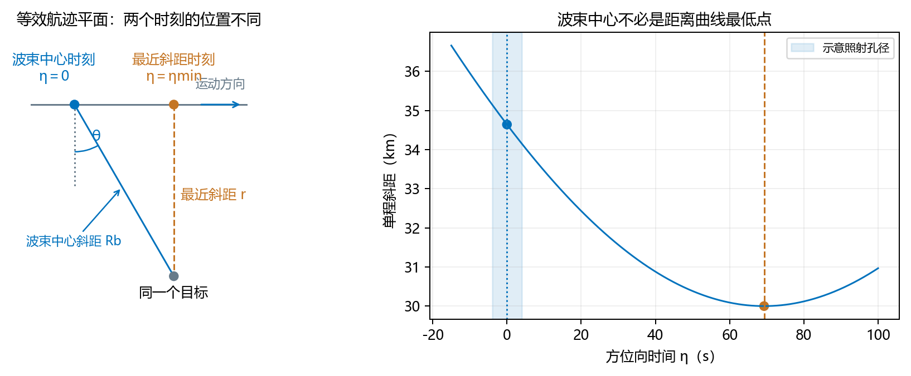

图 5　式（3.6）适用于当前等效斜视模型。左图仅为等效航迹平面，不把最近斜距当作卫星高度；右图的零时刻是波束中心，最低点才是最近距离，且可以在照射孔径之外。

取 $\theta=0$ 时，最近距离时刻才与波束中心重合；非零斜视角通过时间平移保留在式（3.6）中。由式（3.7）还可核对 $R'(0)=-V\sin\theta$，因此零时刻一般仍有非零多普勒。式（3.6）中 $r,\eta_{\min}$ 是固定目标的两个位置参数；在后续傅里叶积分中，积分变量只有 $\tau,\eta$。$V_r(r)$ 的距离依赖一直保留。本文进一步按用户研究范围只讨论距离空变；若等效速度还随方位位置或地形变化，需要增加相应目标参数。

### 3.3 看同一目标：时间求导，没有等效速度的时间导数项

固定 $r,\eta_{\min}$，记 $x=\eta-\eta_{\min}$、$V=V_r(r)$。从 $R^2=r^2+V^2x^2$ 求导：

$$
2RR'=2V^2x,\qquad R'=\frac{V^2x}{R}.
\tag{3.7}
$$

式（3.7）中的 $R'$ 单位 m/s，$x<0$ 时目标接近。这里 $\partial V/\partial\eta=0$ 正是当前假设，对时间求导不产生等效速度的时间导数项。

再用乘积和商法则逐项求导：

$$
R''=\frac{V^2}{R}-\frac{V^2xR'}{R^2}
=\frac{V^2}{R}-\frac{V^4x^2}{R^3}
=\frac{V^2r^2}{R^3}>0.
\tag{3.8}
$$

式（3.8）最后一步用 $R^2-V^2x^2=r^2$ 合并分子。$R''$ 单位 m/s²；其严格正性保证同一目标的 $R'$ 在时间上严格递增，从而在有限孔径内至多有一个驻相点。

为讨论驻相近似，再对式（3.8）求导：

$$
R'''=-\frac{3V^2r^2R'}{R^4}
=-\frac{3V^4r^2x}{R^5}.
\tag{3.9}
$$

式（3.9）单位 m/s³。即使 $V$ 时间不变，斜距仍有高阶时间导数；因此“孔径内常速度”不等于“斜距只保留二次项”。后文保留完整平方根，避免这种额外截断。

### 3.4 换一个目标：距离偏导，空间变化项仍然存在

**偏导数**表示只改变一个自变量，并固定其余自变量。当跨目标改变 $r$，并暂时固定方位参数 $\eta_{\min}$ 时，对式（3.6）求距离偏导：

$$
\left.\frac{\partial R}{\partial r}\right|_{\eta,\eta_{\min}}
=\frac{r+V_r(r)V_{r,r}(r)(\eta-\eta_{\min})^2}{R},
\qquad V_{r,r}(r)=\frac{dV_r}{dr}.
\tag{3.10}
$$

式（3.10）的两个偏导量分别无量纲和 s$^{-1}$。分子第二项来自对不同目标的速度函数求导，不能因为式（3.1）的时间导数为零而删除。若沿实际场景曲线还满足 $\eta_{\min}=\eta_{\min}(r)$，分子还需加上 $-V_r^2(\eta-\eta_{\min})\,d\eta_{\min}/dr$；这是目标方位位置变化带来的链式法则项。

**场景公共时间轴。** 上面的单点推导取该目标的波束中心为零。若对全场景使用同一时间轴，另一个目标的波束中心发生在 $\eta_b$，应把其局部时间写成 $\eta-\eta_b$，于是：

$$
\boxed{\begin{aligned}
R(\eta)&=\sqrt{R_b^2-2R_bV\sin\theta(\eta-\eta_b)+V^2(\eta-\eta_b)^2},\\
\eta_{\min}&=\eta_b+\frac{R_b\sin\theta}{V}.
\end{aligned}}\tag{3.11}
$$

式（3.11）中 $R_b$ 仍是该目标自己的波束中心斜距，而不是随意的公共零时刻斜距。对当前参考目标取 $\eta_b=0$ 就回到式（3.4）和式（3.5）；因此同一场景的不同目标不必同时到达波束中心。后面的最近斜距形式使用各自的 $\eta_{\min}$，可以直接沿用。

**本节交接：** 已经得到完整 $R(\eta)$，并知道对哪个变量求导。下一节只做一件事：把这个距离变成回波的时间延迟和复相位。

## 4. 从距离到信号：时延与相位怎样进入回波

**本节输入：** 上一节的斜距。**本节问题：** 接收的脉冲为什么会平移，又为什么还要保留一个快速变化的相位？

### 4.1 发射脉冲与传播时延

定义发射复包络和对应的解析射频信号：

$$
p(\tau)
=w_r(\tau)e^{j\pi K_r\tau^2},
\qquad
s_{\mathrm{tx}}(\tau)
=p(\tau)e^{j2\pi f_c\tau}.
\tag{4.1}
$$

式（4.1）的 $w_r$ 是距离脉冲包络，可以为矩形或其他有限支撑窗。$K_r\tau^2$ 无量纲；瞬时基带频率是相位除以 $2\pi$ 后对时间求导得到的 $K_r\tau$。采用解析信号便于保留完整复相位，实际发射电压是其相应实部。

在单站停走和无色散传播模型中，往返时延为：

$$
d(\eta)=\frac{2R(\eta)}{c}.
\tag{4.2}
$$

式（4.2）的 $d$ 单位 s，因发射和接收路径在停走模型中相同，单程斜距乘二。它只在当前模型内成立；附录 D 说明如何放宽。

传播后信号延迟 $d$，再乘 $e^{-j2\pi f_c\tau}$ 下变频。把射频载波的时延部分与本振相乘：

$$
e^{j2\pi f_c(\tau-d)}
e^{-j2\pi f_c\tau}
=e^{-j2\pi f_cd}
=e^{-j4\pi f_cR/c}.
\tag{4.3}
$$

式（4.3）推导了基带回波的距离载频相位；其负号来自本文的下变频定义，因往返路径存在而出现 $4\pi$。这个相位是相干成像对毫米级斜距误差敏感的原因。

把散射系数、孔径幅度及脉冲延迟合并：

$$
\boxed{s(\tau,\eta)
=\sigma a(\eta)
w_r\!\left(\tau-\frac{2R(\eta)}{c}\right)
\exp\!\left[j\pi K_r\left(\tau-\frac{2R(\eta)}{c}\right)^2\right]
\exp\!\left[-j\frac{4\pi f_cR(\eta)}{c}\right].}\tag{4.4}
$$

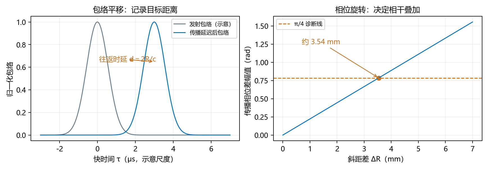

图 6　同一个斜距控制两件事：包络位置与传播相位。左图用高斯包络作平移示意，不替换正文的一般脉冲模型；右图给出 5.3 GHz 时毫米级距离差的相位影响。

式（4.4）是本文所有频谱结论的起点：目标线性、单次散射、平台在一脉冲内冻结、无频率色散；$a$ 不随快时间变化。星载曲轨通过等效参数与剩余误差体现；本节采用式（3.6），固定目标的 $V_r(r)$ 在孔径内不随慢时间变化。若散射响应强烈依赖频率或脉内运动不可忽略，需要从更一般模型重新做快时间变换。

### 4.2 对多个点或连续场景的含义

**线性叠加**表示多个目标的复回波直接相加，而不是先把它们的幅度相加。在线性散射假设下，若 $s_\ell$ 是第 $\ell$ 个目标的回波，先相加再变换与先变换再相加相同：

$$
s_{\mathrm{scene}}=\sum_\ell s_\ell,
\qquad
S_{\mathrm{scene}}=\sum_\ell S_\ell.
\tag{4.5}
$$

式（4.5）只使用积分的线性性。不同目标的 $R_b,u_0,V_r,a$ 通常不同，因此单个目标的精确频谱并不自动构成对整个场景通用的一个平移不变滤波器；空间变化必须另行处理。

**本节交接：** 现在有了双时间回波 $s(\tau,\eta)$。下一节只对 $\tau$ 变换，看看距离平移怎样进入频率相位。

## 5. 第一种混合域：距离频域—方位时域

固定 $\eta$ 后，$R(\eta)$ 对快时间积分为常数。设 $u=\tau-2R/c$，则 $d\tau=du$，且：

$$
e^{-j2\pi f_{\tau}\tau}
=e^{-j2\pi f_{\tau}u}
e^{-j4\pi f_{\tau}R/c}.
\tag{5.1}
$$

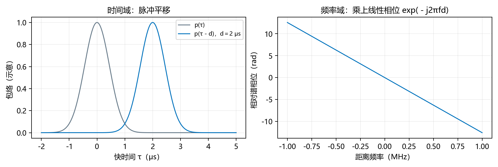

图 7　时间平移在频域中对应线性相位。公式中的换元只是重新量快时间的起点，没有更改目标的真实时延。

式（5.1）展示了时移怎样产生快时间频率相关的传播相位。由于快时间积分覆盖整个脉冲，变量替换后积分范围仍可写成全实轴；若存在固定接收门截断，这一点不能继续直接使用。

定义发射复包络的精确频谱：

$$
P(f_{\tau})
=\int_{-\infty}^{\infty}
w_r(u)e^{j\pi K_ru^2}e^{-j2\pi f_{\tau}u}\,du.
\tag{5.2}
$$

式（5.2）的 $P$ 只由发射波形决定，不包含目标轨道。若 $w_r$ 无量纲，则 $P$ 的单位为 s。这里没有把有限长线性调频信号的频谱近似成矩形幅度。

将式（5.1）代入式（4.4）的快时间傅里叶积分，提出所有与 $u$ 无关的因子，并使用式（5.2）：

$$
S_r(f_{\tau},\eta)
=\sigma a(\eta)P(f_{\tau})
\exp\!\left[-j\frac{4\pi(f_c+f_{\tau})}{c}R(\eta)\right].
\tag{5.3}
$$

式（5.3）是停走模型内的精确距离频域表达式。$f_c+f_{\tau}$ 是对应射频频率；把它替成 $f_c$ 会丢弃距离频率与几何相位的耦合，在宽带和斜视分析中通常不能未经检验使用。

### 5.1 只变换距离时间，方位时间保持不动

式（5.3）已经处于 $(f_\tau,\eta)$ 域。现在完整代入式（3.6）的距离空变等效速度模型，并恢复目标标签：

$$
\boxed{\begin{aligned}
S_r(f_\tau,\eta;r,\eta_{\min})
&=\sigma a(\eta)P(f_\tau)\\
&\quad\times\exp\left[-j\frac{4\pi(f_c+f_\tau)}{c}
\sqrt{r^2+V_r^2(r)(\eta-\eta_{\min})^2}\right].
\end{aligned}}\tag{5.4}
$$

式（5.4）是本模型内**精确的距离频域—方位时域表达式**，没有作方位傅里叶变换，也没有使用驻相法。$P$ 描述发射脉冲的复频谱；$a$ 保留随慢时间变化的照射和幅度；平方根保留完整斜距。对固定目标，$V_r(r)$ 作为常数进入每个慢时间位置的相位，而不同距离目标使用不同数值。

### 5.2 匹配滤波：让同一脉冲的能量在正确时移处累加

若采用理想距离匹配滤波器 $H_{\mathrm{rc}}(f_\tau)=P^*(f_\tau)$，只对发射波形频谱取共轭，则同一域中的输出为：

$$
\begin{aligned}
S_r^{\mathrm{rc}}(f_\tau,\eta)
&=H_{\mathrm{rc}}(f_\tau)S_r(f_\tau,\eta)\\
&=\sigma a(\eta)|P(f_\tau)|^2
\exp\left[-j\frac{4\pi(f_c+f_\tau)}c R(\eta)\right].
\end{aligned}\tag{5.5}
$$

式（5.5）的上标 $\mathrm{rc}$ 表示已作距离匹配滤波。滤波器没有消除 $R(\eta)$ 引起的时延与载频传播相位；尤其不能把整个 $S_r$ 取共轭后称为只做距离压缩。若有接收机频带、距离加窗或增益，应把其传递函数另外乘入。

为说明压缩后的距离脉冲形状，定义发射包络的自相关函数：

$$
\boxed{C_p(v)=\int_{\mathbb R}|P(f_\tau)|^2e^{j2\pi f_\tau v}df_\tau
=\int_{\mathbb R}p(u)p^*(u-v)du.}\tag{5.6}
$$

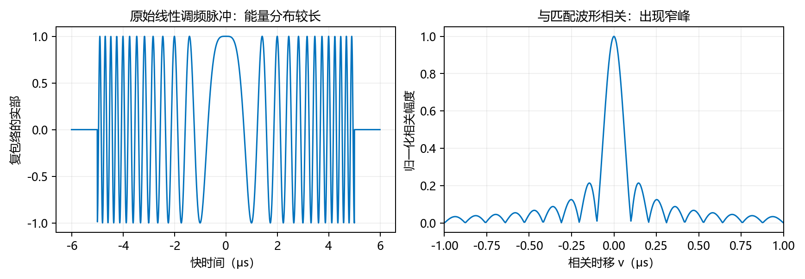

图 8　匹配滤波等价于把回波与已知脉冲模板作相关。相关就是沿时移滑动模板并比较重合程度；模板与信号相位匹配时出现窄峰。图为矩形线性调频脉冲的数值示意。

**卷积**是对所有平移位置的乘积作累加；**相关**在这里用共轭模板比较波形相似性。式（5.6）中的 $u,v$ 为快时间量，单位 s。第二个等号可由卷积与傅里叶变换关系逐步核对：$p^*(-t)$ 的频谱为 $P^*(f_\tau)$，它与 $p(t)$ 卷积得到 $\int p(u)p^*(u-v)du$，频谱恰为 $|P|^2$。若 $p$ 无量纲，$C_p$ 的单位为 s；它不是原始发射包络 $p$。

将式（5.5）中的传播相位分成载频项与距离频率项，再按正指数作距离逆变换：

$$
\begin{aligned}
s^{\mathrm{rc}}(\tau,\eta)
&=\sigma a(\eta)e^{-j4\pi f_cR(\eta)/c}
\int_{\mathbb R}|P(f_\tau)|^2
e^{j2\pi f_\tau[\tau-2R(\eta)/c]}df_\tau\\
&=\sigma a(\eta)C_p\left(\tau-\frac{2R(\eta)}c\right)
e^{-j4\pi f_cR(\eta)/c}.
\end{aligned}\tag{5.7}
$$

式（5.7）是在距离时域—方位时域中的压缩回波，用于下面建立已压缩的距离多普勒表达式。它对理想匹配滤波与完整接收模型是精确关系，并没有同时完成距离徙动校正、SRC 或方位压缩。

**本节交接：** 框内距离频域表达式仍保留 $\eta$，还没有作方位变换。下一节从同一时域回波建立另一个混合域，再把两条变换路线接到二维频谱。

## 6. 第二种混合域与二维频谱：接通两条变换路线

**本节输入：** 同一份原始时域回波。**本节输出：** 另一种混合域，以及两种混合域与二维频谱的关系。

### 6.1 只变换方位时间：得到距离多普勒域

距离多普勒域保留距离时间 $\tau$，只把方位时间变换为 $f_\eta$。固定目标和 $\tau$，将式（4.4）直接代入方位傅里叶变换：

$$
\boxed{\begin{aligned}
S_{\mathrm{RD}}(\tau,f_\eta;r,\eta_{\min})
&=\int_I s(\tau,\eta;r,\eta_{\min})e^{-j2\pi f_\eta\eta}d\eta\\
&=\sigma\int_I a(\eta)w_r\left(\tau-\frac{2R(\eta)}c\right)\\
&\quad\times\exp\left[j\pi K_r\left(\tau-\frac{2R(\eta)}c\right)^2
-j\frac{4\pi f_cR(\eta)}c-j2\pi f_\eta\eta\right]d\eta.
\end{aligned}}\tag{6.1}
$$

式（6.1）是**未作距离压缩的精确距离多普勒表达式**，其中 $R(\eta)=\sqrt{r^2+V_r^2(r)(\eta-\eta_{\min})^2}$。快时间 $\tau$ 在积分中固定，但脉冲内偏移 $\tau-2R(\eta)/c$ 随方位时间变化，所以原始距离调频相位仍在积分内部。$f_\eta$ 与 $\eta$ 共轭，$\tau$ 此时没有变成距离频率。

### 6.2 如果先做了距离压缩，哪个部分会改变

对式（5.7）只作方位傅里叶变换，得到：

$$
\boxed{\displaystyle
S_{\mathrm{RD}}^{\mathrm{rc}}(\tau,f_\eta)
=\sigma\int_I a(\eta)
C_p\left(\tau-\frac{2R(\eta)}c\right)
e^{-j[4\pi f_cR(\eta)/c+2\pi f_\eta\eta]}d\eta.}
\tag{6.2}
$$

式（6.2）与式（6.1）的区别在于：距离脉冲已经由原始线性调频波形换为自相关压缩波形 $C_p$；载频几何相位和方位变换因子继续保留。即使脉冲已压缩，压缩包络的中心仍随 $\eta$ 徙动，所以该精确积分一般不能直接把 $C_p$ 从积分中提出。

### 6.3 再变换另一维：得到二维频谱

将式（5.3）作方位傅里叶变换，定义：

$$
F=f_c+f_\tau,\qquad k=\frac{4\pi F}{c},
\qquad \Phi(\eta)=kR(\eta;r,\eta_{\min})+2\pi f_\eta\eta.
\tag{6.3}
$$

式（6.3）中的 $F$ 单位 Hz，$k$ 是往返径向波数、单位 rad/m，$\Phi$ 为无量纲相位。正常雷达频带内 $F>0$。固定目标后，$r,\eta_{\min},V_r(r)$ 都是积分参数。

$$
\boxed{\displaystyle
\begin{aligned}
S(f_\tau,f_\eta;r,\eta_{\min})
&=\sigma P(f_\tau)\int_I a(\eta)e^{-j\Phi(\eta)}d\eta,\\
\Phi(\eta)&=k\sqrt{r^2+V_r^2(r)(\eta-\eta_{\min})^2}+2\pi f_\eta\eta.
\end{aligned}}
\tag{6.4}
$$

式（6.4）对当前停走和等效双曲模型是严格相等的有限孔径频谱，没有使用驻相法。由于脉冲、孔径有限且幅度可积，可以依次完成快时间与慢时间积分。这也说明孔径内常速度并不妨碍保留有限孔径频谱的精确性。

若要计算选定真实轨道模型的频谱，可在同一结构中将根号整体替换成 $R_{\mathrm{true}}(\eta;\boldsymbol p)$。这样得到真实几何的模型内精确积分，但一般不能继续使用第 7 节的双曲线闭式驻相点。频谱是否有有限初等闭式，取决于孔径权和斜距函数，不能仅由速度在时间上不变这一条判断。

### 6.4 沿图 3 走不同路线，必须得到同一信号

也可由二维频谱仅对距离频率作逆变换得到同一结果：

$$
\begin{aligned}
S_{\mathrm{RD}}(\tau,f_\eta)
&=\int_{\mathbb R}S(f_\tau,f_\eta)e^{j2\pi f_\tau\tau}df_\tau,\\
S(f_\tau,f_\eta)&=\int_{\mathbb R}S_{\mathrm{RD}}(\tau,f_\eta)
e^{-j2\pi f_\tau\tau}d\tau.
\end{aligned}
\tag{6.5}
$$

式（6.5）两侧关系的正、负指数分别对应距离逆变换和正变换。证明时先将式（6.4）中的 $S$ 代入第一式，再把 $P(f_\tau)e^{-j4\pi f_\tau R/c}$ 逆变换为 $p(\tau-2R/c)$，剩下的方位积分就是式（6.1）。可积性成立时可直接交换积分；若有限矩形脉冲使逆积分不是绝对收敛，则按傅里叶反演的 $L^2$（有限能量信号的均方收敛）或对称截断极限解释，并在连续点取值。式（6.1）以有限孔径和有限脉冲定义原始变换，不依赖形式上的非收敛交换。

利用距离匹配滤波只依赖 $f_\tau$，也可以在二维频域先乘 $P^*$，然后只作距离逆变换：

$$
S_{\mathrm{RD}}^{\mathrm{rc}}(\tau,f_\eta)
=\int_{\mathbb R}P^*(f_\tau)S(f_\tau,f_\eta)
e^{j2\pi f_\tau\tau}df_\tau.
\tag{6.6}
$$

式（6.6）代入式（6.4）后，距离频率积分变成式（5.6）的 $C_p(\tau-2R/c)$，从而回到式（6.2）。由于 $P^*P=|P|^2$ 可积，这个反演关系在有界可积孔径权下比原始未压缩脉冲的反演更直接。第 9.3 节再给出常用的闭式近似及其成立条件。

**本节交接：** 到这里所有表示式都是所选模型内的精确积分。难点是方位积分往往不好直接算；下一节先找出对积分贡献最集中的时间位置。

## 7. 找出主要贡献时刻：解析求解驻相点和相位

**本节问题：** 为什么一个方位频率主要由某段观测时间贡献？相位导数就是箭头的转动快慢；在转动暂时停下来附近，邻近贡献更容易同向累加。这种位置叫**驻相点**。

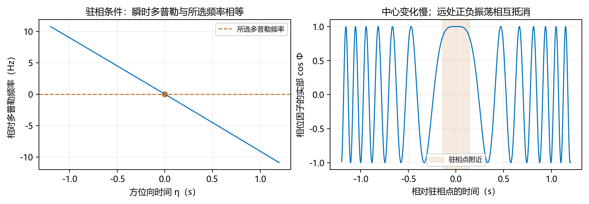

图 9　驻相点的两种读法：瞬时多普勒与所选频率相等；相邻时间的复指数方向接近。远离该点时正负振荡通常相消，但有限端点贡献仍需另外检查。

### 7.1 驻相条件对应瞬时多普勒

固定目标标签和频率坐标，对式（6.3）的相位求慢时间导数：

$$
\boxed{\Phi'=kR'+2\pi f_\eta,
\qquad \Phi'(\eta_s)=0
\ \Longleftrightarrow\
R'(\eta_s)=-\frac{c f_\eta}{2F}.}\tag{7.1}
$$

式（7.1）右侧单位为 m/s。距离频域回波的相位是 $-kR$，其瞬时频率为 $f_D=-kR'/(2\pi)=-2FR'/c$，因此驻相条件就是 $f_\eta=f_D(\eta_s)$。接近时 $R'<0$，本文约定下多普勒为正。$F=f_c+f_\tau$ 必须保留。

将式（3.7）的导数代入，并定义无量纲量 $\alpha$：

$$
\frac{V^2(\eta_s-\eta_{\min})}{R_s}=-\frac{c f_\eta}{2F},
\qquad
\alpha=-\frac{c f_\eta}{2FV},
\qquad \frac{V(\eta_s-\eta_{\min})}{R_s}=\alpha.
\tag{7.2}
$$

式（7.2）中的 $R_s=R(\eta_s)$、$V=V_r(r)$。由于 $r>0$，有 $|V(\eta_s-\eta_{\min})|<R_s$，有限实驻相点要求 $|\alpha|<1$。这里没有任何 $V$ 的时间导数，因为固定目标的 $V$ 已视为常数。

令 $D=\sqrt{1-\alpha^2}>0$。用未平方的关系保留符号，联立 $R_s^2=r^2+V^2(\eta_s-\eta_{\min})^2$：

$$
\begin{aligned}
R_s^2&=r^2+\alpha^2R_s^2,\\
R_s^2(1-\alpha^2)&=r^2,\qquad R_s=\frac rD,\\
\eta_s-\eta_{\min}&=\frac{\alpha R_s}{V}
=\frac{\alpha r}{VD},\\
\boxed{\eta_s=\eta_{\min}+\frac{\alpha r}{VD}.}
\end{aligned}\tag{7.3}
$$

式（7.3）选择正斜距支，时间偏移的符号仍由式（7.2）决定，因此没有因平方而丢失接近或远离分支。它是模型内精确驻相点，不需要级数反演。不同距离目标的 $V_r(r)$ 不同，应对每个目标代入自己的速度。

### 7.2 代回相位，不对斜距作二次截断

使用 $2\pi f_\eta=-kV\alpha$，分开最近距离时刻与时间偏移：

$$
\begin{aligned}
\Phi_s
&=kR_s+2\pi f_\eta\eta_s\\
&=kR_s+2\pi f_\eta\eta_{\min}-kV\alpha(\eta_s-\eta_{\min})\\
&=kR_s+2\pi f_\eta\eta_{\min}-k\alpha^2R_s\\
&=kR_s(1-\alpha^2)+2\pi f_\eta\eta_{\min}\\
&=krD+2\pi f_\eta\eta_{\min}.
\end{aligned}\tag{7.4}
$$

式（7.4）第三行由 $V(\eta_s-\eta_{\min})=\alpha R_s$ 得到；最后一行使用 $R_s=r/D$ 与 $1-\alpha^2=D^2$。每一步都保留完整双曲斜距，不把 $R$ 换成关于时间的二次多项式。

将 $k,\alpha,D$ 换回频率变量，定义驻相几何相位 $\Psi$：

$$
\boxed{\displaystyle
\Psi(f_\tau,f_\eta;r,\eta_{\min})
=\frac{4\pi r}{c}
\sqrt{(f_c+f_\tau)^2-\left[\frac{c f_\eta}{2V_r(r)}\right]^2}
+2\pi f_\eta\eta_{\min}.}
\tag{7.5}
$$

式（7.5）是本次修订的核心相位公式。$r$ 是最近斜距；若从波束中心斜距 $R_b$ 表示出发，必须用 $r=R_b\cos\theta$，不能在斜视时直接把 $r$ 写成 $R_b$。根内两项单位均为 Hz²，开方后乘 $r/c$ 为无量纲相位。式中的 $V_r(r)$ 保留距离空变，并未被一个全场景常数替代。

该公式精确表示所选模型的驻相相位，尚不等于有限孔径频谱本身。$F>0$、$|\alpha|<1$、$\eta_s\in(\eta_a,\eta_b)$ 是使用内部驻相贡献的条件。真实信号的主要方位频率范围还由有限孔径内的瞬时多普勒决定：

$$
f_D(\eta;f_\tau,r)
=-\frac{2F}{c}\frac{V_r^2(r)(\eta-\eta_{\min})}{R(\eta)},
\qquad
f_\eta\in\{f_D(\eta):\eta\in I\}
\quad\text{对应孔径内驻相分支}.
\tag{7.6}
$$

式（7.6）描述的是内部驻相分支的频率范围，不表示有限窗频谱在范围外严格为零。由于 $R''>0$，$F>0$ 时 $f_D$ 随时间严格递减，给定范围内的频率只对应一个驻相时刻。

**本节交接：** 已经精确求出模型的驻相时刻和该时刻的相位，还没有算完整积分的幅度。下一节才引入驻相积分近似，并标出近似从哪里开始。

## 8. 从驻相点到频谱幅度：近似从这里开始

**本节输入：** 精确驻相点与相位。**本节输出：** 一个易于计算的首阶频谱近似。这里的“首阶”指先保留主导贡献，不表示原始斜距只有二次项。

### 8.1 近似出现在哪一步

**非退化**在这里指二阶相位导数不为零，也就是局部还能用一条有弯曲的抛物线表示相位。在孔径内部满足这一条件的驻相点，令 $x=\eta-\eta_s$，并在该邻域展开相位：

$$
\Phi(\eta_s+x)=\Psi+\underbrace{\Phi'_s x}_{=0}
+\frac{kR''_s}{2}x^2+\frac{kR'''_s}{6}x^3+\cdots.
\tag{8.1}
$$

式（8.1）中的 $R''_s,R'''_s$ 是同一目标沿时间的导数。首阶驻相法只在局部积分中保留二次相位，并把缓变幅度替成 $a_s=a(\eta_s)$。舍去高阶相位、幅度变化并处理为无限局部积分，正是近似来源；不能因为式（7.3）和式（7.5）解析精确就删除这部分误差。

**高斯积分**通常积累形如指数二次函数的贡献；这里指数带虚数，表示二次相位振荡。为先让积分收敛，加入一个微小衰减，再把衰减趋于零；这一步称为**正则化**。为计算局部振荡高斯积分，先加入 $\varepsilon>0$ 的收敛因子：

$$
\begin{aligned}
G_\varepsilon
&=\int_{\mathbb R}e^{-(\varepsilon+jkR''_s/2)x^2}dx
=\sqrt{\frac{\pi}{\varepsilon+jkR''_s/2}},\\
\lim_{\varepsilon\downarrow0}G_\varepsilon
&=\sqrt{\frac{2\pi}{kR''_s}}e^{-j\pi/4}.
\end{aligned}\tag{8.2}
$$

式（8.2）取从正实部连续延拓的平方根支。因为本模型 $k>0$、$R''_s>0$，分母虚数的辐角趋于 $\pi/2$，开平方并取倒数后给出 $-\pi/4$。若使用不同傅里叶符号，不能机械照抄这个修正相位。

将局部常数相位与幅度提出，再乘式（8.2），得到：

$$
S_{\mathrm{SPA}}
=\sigma P(f_\tau)a(\eta_s)
\sqrt{\frac{2\pi}{kR''_s}}
e^{-j\Psi-j\pi/4},
\qquad S\approx S_{\mathrm{SPA}}.
\tag{8.3}
$$

式（8.3）中 $\sqrt{2\pi/(kR''_s)}$ 的单位为 s，保留了频谱幅度而不是只给相位。$P$ 可以使用第 5 节的精确积分定义，或附录 E 的有限矩形脉冲精确频谱，无需再引入距离线性调频信号的大时宽带宽积近似。有限孔径的真正精确值仍是式（6.4）。

由式（3.8）和 $R_s=r/D$，逐项代入：

$$
R''_s=\frac{V^2r^2}{(r/D)^3}=\frac{V^2D^3}{r},
\qquad
\sqrt{\frac{2\pi}{kR''_s}}
=\sqrt{\frac{cr}{2FV^2D^3}}.
\tag{8.4}
$$

式（8.4）表明速度空变也进入谱幅度，且经 $D$ 进一步影响频谱曲率。于是完整的首阶驻相谱可写为：

$$
\boxed{\displaystyle
\begin{aligned}
S_{\mathrm{SPA}}(f_\tau,f_\eta;r,\eta_{\min})
&=\sigma P(f_\tau)a(\eta_s)\sqrt{\frac{cr}{2F V_r^2(r)D^3}}\\
&\quad\times\exp[-j\Psi(f_\tau,f_\eta;r,\eta_{\min})-j\pi/4].
\end{aligned}}
\tag{8.5}
$$

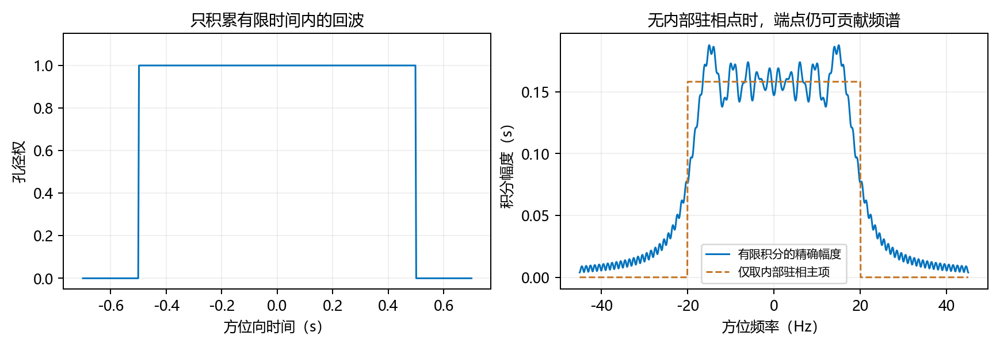

图 10　精确积分与首阶近似的区别。图用有限矩形孔径的二次相位教学积分说明端点效应，不是实际卫星数据；没有内部驻相点也不代表精确频谱为零。

式（8.5）必须连同式（7.3）的驻相时刻、式（7.5）的相位和适用频率分支共同使用。对不同距离，不能只修改幅度中的 $V_r$ 却保留根内的全场景参考速度，反之亦然。

### 8.2 首阶近似、端点和精确积分的关系

定义局部同相时间尺度和两个无量纲诊断量：

$$
\ell_\eta=(kR''_s)^{-1/2},\qquad
\epsilon_3=\frac{|kR'''_s|\ell_\eta^3}{6},\qquad
\epsilon_a=\left|\frac{a'_s}{a_s}\right|\ell_\eta.
\tag{8.6}
$$

式（8.6）的 $\ell_\eta$ 单位 s；幅度非零时，若后两个量小、驻相点距离端点远大于 $\ell_\eta$，首阶局部近似更有依据。还应检查更高阶导数。它们是预筛选量，不是任意孔径上的严格统一误差界；**渐近近似**指在相位振荡越来越快等指定极限下，主导项越来越能代表积分；有限参数下仍有余项。驻相方法的这种性质见 [NIST DLMF §2.3(iv)](https://dlmf.nist.gov/2.3#iv)。

在没有驻相点且 $\Phi'\ne0$ 的区间，用 $d(e^{-j\Phi})/d\eta=-j\Phi'e^{-j\Phi}$ 分部积分：

$$
\int_{\eta_a}^{\eta_b}a e^{-j\Phi}d\eta
=\left[\frac{a e^{-j\Phi}}{-j\Phi'}\right]_{\eta_a}^{\eta_b}
-\int_{\eta_a}^{\eta_b}\frac{d}{d\eta}
\left(\frac{a}{-j\Phi'}\right)e^{-j\Phi}d\eta.
\tag{8.7}
$$

式（8.7）是精确恒等式，第一项说明有限孔径端点可产生非零贡献。驻相点接近端点时，应采用有限区间 Fresnel 或一致渐近方法，或直接计算式（6.4）。保留双曲线平方根的相位不能代替这些有限孔径处理。

**本节交接：** 现在可以使用二维驻相谱，但保留完整平方根。下一节按距离频率展开这个平方根，解释算法中的 RCMC、SRC 与距离多普勒闭式。

## 9. 读懂耦合：距离徙动、SRC 与距离多普勒闭式

**本节输入：** 完整平方根驻相相位。**本节问题：** 为什么脉冲中心随方位频率变化？为什么做了距离压缩仍可能需要 SRC？

**泰勒展开**是用某一点的函数值、斜率及更高阶导数构造局部多项式；它不是在整个频带上任意拟合。所谓“保留到二阶”就是保留常数、一次和二次项，剩下的项统称截断余项。

### 9.1 对距离频率求导时固定目标距离

固定 $r,\eta_{\min},f_\eta$，定义：

$$
\beta(r,f_\eta)=\frac{c f_\eta}{2V_r(r)},
\qquad G(f_\tau)=\sqrt{(f_c+f_\tau)^2-\beta^2},
\qquad D_0=\sqrt{1-\frac{\beta^2}{f_c^2}}.
\tag{9.1}
$$

式（9.1）的 $\beta,G$ 单位 Hz，$D_0$ 无量纲；$D_0$ 是距离频率为零处的 $D$。固定一个目标时，对 $f_\tau$ 求导不需要 $dV_r/dr$，因为目标距离并没有随频率改变。空间变化和频率依赖是不同的自变量关系。

令 $F=f_c+f_\tau$，则 $dF/df_\tau=1$。从 $G^2=F^2-\beta^2$ 逐次求导：

$$
\begin{aligned}
G'&=\frac FG,\\
G''&=\frac1G-\frac{F G'}{G^2}
=\frac1G-\frac{F^2}{G^3}
=-\frac{\beta^2}{G^3},\\
G'''&=\frac{3\beta^2G'}{G^4}
=\frac{3\beta^2F}{G^5}.
\end{aligned}\tag{9.2}
$$

式（9.2）中的撇号在本小节专指对 $f_\tau$ 求导，和第 3 节的慢时间导数区别使用。每行分别应用链式和商法则；第二行最后一步使用 $G^2-F^2=-\beta^2$。

在 $f_\tau=0$ 处，$G=f_cD_0$，代入泰勒公式并保留三阶：

$$
\begin{aligned}
G(f_\tau)=f_cD_0
&+\frac{f_\tau}{D_0}
-\frac{\beta^2 f_\tau^2}{2 f_c^3D_0^3}
+\frac{\beta^2 f_\tau^3}{2 f_c^4D_0^5}
+O(f_\tau^4).
\end{aligned}\tag{9.3}
$$

式（9.3）的二阶系数来自 $G''(0)/2!$，三阶系数来自 $G'''(0)/3!$；三阶导数中的 3 与 $3!=6$ 相除后得到分母中的 2。各项均为 Hz。该展开是局部频率展开，保留完整 $G$ 则不产生这项截断误差。

### 9.2 逐阶解释几何相位

把式（9.3）乘 $4\pi r/c$ 并加入时间平移项：

$$
\begin{aligned}
\Psi=&\underbrace{\frac{4\pi r f_cD_0}{c}
+2\pi f_\eta\eta_{\min}}_{\Psi_0}
+\underbrace{\frac{4\pi r}{cD_0}f_\tau}_{\Psi_1}\\
&\underbrace{-\frac{2\pi r\beta^2}{c f_c^3D_0^3}f_\tau^2}_{\Psi_2}
+\underbrace{\frac{2\pi r\beta^2}{c f_c^4D_0^5}f_\tau^3}_{\Psi_3}
+O(f_\tau^4).
\end{aligned}\tag{9.4}
$$

式（9.4）的 $\Psi_0$ 为距离频率零阶方位相位与目标方位位置相位；$\Psi_1$ 线性于距离频率，对应随方位频率变化的距离时延；$\Psi_2$ 是几何二次距离频率相位，形成 SRC 需求；$\Psi_3$ 及更高项属于高阶耦合。这里未包含发射波形频谱 $P$ 的相位，不能把几何 SRC 与发射波形匹配滤波混为一步。

由式（7.5）对距离频率求导，**群时延**在这里是相位对频率的斜率除以 $2\pi$，单位 s，用它定位距离脉冲中心。驻相几何群时延为：

$$
\boxed{\tau_g=\frac1{2\pi}\frac{\partial\Psi}{\partial f_\tau}
=\frac{2r}{c}\frac{F}{G}
=\frac{2r}{cD},
\qquad \tau_g(0,f_\eta)=\frac{2r}{cD_0}.}\tag{9.5}
$$

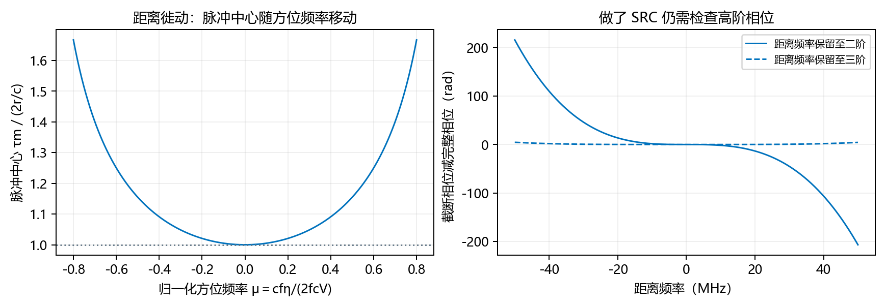

图 11　两个不同问题。左图是距离脉冲中心随方位频率移动，对应 RCMC；右图是二、三阶距离频率相位与完整平方根的差，对应 SRC 后仍需检查的高阶残差。

式（9.5）单位 s，等于 $2R_s/c$，因为 $R_s=r/D$。它随 $f_\eta$ 变化，表达距离徙动；它也随 $V_r(r)$ 变化，因此正确距离徙动校正需要目标距离对应的参数。该群时延由驻相相位定义，不是谱零点附近精确有限孔径谱相位的一般导数结论。

回波几何因子是 $e^{-j\Psi}$，其中二次部分为 $e^{-j\Psi_2}$。若只取消该部分，相应的 SRC 因子应取：

$$
\boxed{H_{\mathrm{SRC},2}(f_\tau,f_\eta;r)=e^{+j\Psi_2}
=\exp\left[-j\frac{2\pi r\beta^2}{c f_c^3D_0^3}f_\tau^2\right].}\tag{9.6}
$$

式（9.6）的负号由 $\Psi_2$ 本身为负决定；乘积 $e^{-j\Psi_2}e^{+j\Psi_2}=1$ 验证了校正符号。距离匹配滤波另外乘 $P^*(f_\tau)$，只针对发射波形频谱，不应取整个回波频谱的共轭。

如果 $G_N$ 是保留至 $N$ 阶的距离频率多项式，则几何相位截断误差为：

$$
\Delta\Psi_N=\frac{4\pi r}{c}[G-G_N].
\tag{9.7}
$$

式（9.7）不把有限阶余项当作已知为零。随着斜视对应的 $D_0$ 减小，式（9.3）的 $D_0^{-3},D_0^{-5}$ 放大二阶和三阶系数。是否需要保留完整平方根或更多高阶项，应在实际带宽、距离和方位频率支撑内检查，而不是只规定一个最大斜视角。

### 9.3 距离多普勒域的常用闭式近似及其来源

为了明确所保留的处理频带，取已知距离频带窗 $W_{\mathcal B}(f_\tau)$，其支撑为 $\mathcal B$。定义两种距离频谱权和对应的距离脉冲：

$$
\begin{aligned}
Q_{\mathrm{raw}}(f_\tau)&=W_{\mathcal B}(f_\tau)P(f_\tau),\\
Q_{\mathrm{rc}}(f_\tau)&=W_{\mathcal B}(f_\tau)|P(f_\tau)|^2,\\
q_\nu(v)&=\int_{\mathcal B}Q_\nu(f_\tau)e^{j2\pi f_\tau v}df_\tau,
\quad\nu\in\{\mathrm{raw},\mathrm{rc}\}.
\end{aligned}\tag{9.8}
$$

式（9.8）中 $W_{\mathcal B}$ 无量纲，并明确计入额外距离频带选择。$q_{\mathrm{raw}}$ 是带窗后的原始发射脉冲，$q_{\mathrm{rc}}$ 是同一带窗后的距离压缩脉冲。若不加额外窗且在全频率上反演，它们分别还原为 $p$ 与 $C_p$。有限矩形脉冲的频谱并不严格限带，因此使用有限频带时应保留这一带窗定义，而不是暗中把频带外能量当成严格为零。

将二维驻相谱的幅度因子单独记为 $A(f_\tau)$，再取距离频率零点处的值：

$$
\begin{aligned}
A(f_\tau)&=a[\eta_s(f_\tau,f_\eta)]
\sqrt{\frac{cr}{2(f_c+f_\tau)V_r^2(r)D^3(f_\tau,f_\eta)}},\\
\eta_0&=\eta_s(0,f_\eta),\qquad
A_0=a(\eta_0)\sqrt{\frac{cr}{2f_cV_r^2(r)D_0^3}},\\
\tau_m&=\frac{2r}{cD_0},\qquad
\Psi_0=\frac{4\pi r f_cD_0}{c}+2\pi f_\eta\eta_{\min}.
\end{aligned}\tag{9.9}
$$

式（9.9）的 $A,A_0$ 单位为 s；$\eta_0$ 是载频对应的驻相时刻，不是任意选定的孔径中心。$\tau_m$ 是距离频率零点的几何群时延，单位 s；$\Psi_0$ 是式（9.4）的零阶几何相位。$D_0$ 和所有量仍使用当前目标的 $V_r(r)$。

把式（8.5）代入精确反演关系（6.5）或（6.6），对同一处理带窗保留距离积分：

$$
S_{\mathrm{RD},\mathcal B}^{\nu}(\tau,f_\eta)
\approx\sigma e^{-j\pi/4}
\int_{\mathcal B}Q_\nu(f_\tau)A(f_\tau)
e^{-j\Psi(f_\tau,f_\eta)}e^{j2\pi f_\tau\tau}df_\tau.
\tag{9.10}
$$

式（9.10）只引入二维驻相近似，尚未把距离频率依赖全部冻结；$\nu=\mathrm{raw}$ 表示未做距离匹配滤波但已加带窗，$\nu=\mathrm{rc}$ 表示已做距离匹配滤波并加相同带窗。保留完整 $\Psi$ 时，RCMC、SRC 及高阶耦合仍由这一个距离积分共同体现。

若在所保留频带上允许 $A(f_\tau)\approx A_0$，且允许把相位线性化为 $\Psi\approx\Psi_0+2\pi f_\tau\tau_m$，则按顺序提出常数因子、合并指数，再使用式（9.8）：

$$
\begin{aligned}
S_{\mathrm{RD},\mathcal B}^{\nu}(\tau,f_\eta)
&\approx\sigma A_0e^{-j\Psi_0-j\pi/4}
\int_{\mathcal B}Q_\nu(f_\tau)
e^{j2\pi f_\tau(\tau-\tau_m)}df_\tau\\
&=\sigma A_0q_\nu(\tau-\tau_m)e^{-j\Psi_0-j\pi/4}.
\end{aligned}\tag{9.11}
$$

式（9.11）明确展示距离多普勒域中“迁移距离脉冲乘方位相位”的来源：它需要**驻相近似、幅度频率冻结和相位对距离频率的一阶截断**。只做距离匹配滤波本身，并不使后两项近似自动成立。

对距离压缩的情况，完整写出该常用表达式：

$$
\boxed{\begin{aligned}
S_{\mathrm{RD},\mathcal B}^{\mathrm{rc}}(\tau,f_\eta;r,\eta_{\min})
&\approx\sigma a(\eta_0)
\sqrt{\frac{cr}{2f_cV_r^2(r)D_0^3}}
q_{\mathrm{rc}}\left(\tau-\frac{2r}{cD_0}\right)\\
&\quad\times\exp\left[-j\frac{4\pi r f_cD_0}{c}
-j2\pi f_\eta\eta_{\min}-j\frac\pi4\right].
\end{aligned}}\tag{9.12}
$$

式（9.12）的距离脉冲中心 $2r/(cD_0)$ 随 $f_\eta$ 和目标距离对应的 $V_r(r)$ 变化，这就是待校正的距离徙动。根号因子是相干积累幅度，指数中仍保留方位压缩所需的几何相位与目标方位位置相位。若求未压缩的带窗回波，在同样的额外近似条件下，将 $q_{\mathrm{rc}}$ 替成 $q_{\mathrm{raw}}$ 即得到式（9.11）的原始回波分支。

以单目标表达式说明徙动校正的坐标关系，令：

$$
\Delta\tau_m=\frac{2r}{c}\left(\frac1{D_0}-1\right),
\qquad \tau'=\tau-\Delta\tau_m,
\qquad \tau-\frac{2r}{cD_0}=\tau'-\frac{2r}{c}.
\tag{9.13}
$$

式（9.13）中 $\tau'$ 是校正后的距离时间坐标，不是新的采集时间；最后一个等号由代入 $\tau=\tau'+\Delta\tau_m$ 得到。目标脉冲中心于是对齐到最近斜距 $r$。这是逐目标的坐标诊断，实际全场景算法仍需处理距离空变与复数插值，也没有因此消除方位相位或已忽略的 SRC、高阶项。

这组闭式近似的额外精度条件可明确写为：

$$
\begin{aligned}
\epsilon_A&=\sup_{f_\tau\in\mathcal B}
\left|\frac{A(f_\tau)}{A_0}-1\right|\ll1,\qquad A_0\ne0,\\
\epsilon_\Psi&=\sup_{f_\tau\in\mathcal B}
|\Psi(f_\tau,f_\eta)-\Psi_0-2\pi f_\tau\tau_m|\ll1.
\end{aligned}\tag{9.14}
$$

式（9.14）中的 $\sup$ 表示在所选频带内取上确界，可先理解为需要控制的最大值；$\ll1$ 表示远小于 1。两量无量纲，并要求整个处理频带的驻相点都位于有效孔径内部、满足第 8 节的条件。若已额外施加 SRC，应将其相位先计入式（9.10），再对剩余相位检查同类误差；不能忽略较大的 $\Psi_2$ 却把式（9.12）当作已经精确完成 SRC 的结果。

令 $J_\nu$ 为式（9.10）的右侧积分值，$L_\nu$ 为式（9.11）第二行的闭式值，则对这个额外线性化步骤有绝对误差界：

$$
|J_\nu-L_\nu|
\le |\sigma A_0|(\epsilon_A+\epsilon_\Psi)
\int_{\mathcal B}|Q_\nu(f_\tau)|df_\tau.
\tag{9.15}
$$

式（9.15）用 $\delta\Psi=\Psi-\Psi_0-2\pi f_\tau\tau_m$，把积分中幅相差写成 $(A-A_0)e^{-j\delta\Psi}+A_0(e^{-j\delta\Psi}-1)$，再分别用式（9.14）和 $|e^{-jx}-1|\le|x|$ 估计得到。该界只控制幅度冻结和相位线性化误差；真实精确距离多普勒谱与 $J_\nu$ 之间还包含驻相近似误差，不能用这个界一并覆盖。

**本节交接：** 单个目标的公式已齐全。下一节改变目标距离，检查为什么不能把所有目标的速度和校正参数都设成同一个参考值。

## 10. 从单点到全场景：距离空变速度带来的误差

**本节输入：** 每个目标各自的驻相相位。**本节操作：** 固定采集频率，换一个距离不同的目标。此时要重新使用该目标的 $V_r(r)$，而不是沿时间改变速度。

### 10.1 对目标距离求偏导时保留速度的距离导数

固定 $f_\tau,f_\eta,\eta_{\min}$，只改变目标距离标签 $r$。从式（9.1）先对 $\beta$ 求导，再对根号求导：

$$
\frac{\partial\beta}{\partial r}=-\frac{\beta}{V_r}V_{r,r},
\qquad
\frac{\partial G}{\partial r}
=-\frac{\beta}{G}\frac{\partial\beta}{\partial r}
=\frac{\beta^2V_{r,r}}{G V_r}.
\tag{10.1}
$$

式（10.1）中的 $V_{r,r}=dV_r/dr$ 是不同距离目标之间的变化率，单位 s$^{-1}$，不是时间加速度。$\partial G/\partial r$ 的单位为 Hz/m。固定目标作傅里叶变换时无需该项；做空间变化分析时则不能删除它。

因此，相位对距离的偏导为：

$$
\left.\frac{\partial\Psi}{\partial r}\right|_{f_\tau,f_\eta,\eta_{\min}}
=\frac{4\pi}{c}\left[G+
\frac{r\beta^2V_{r,r}}{G V_r}\right].
\tag{10.2}
$$

式（10.2）的第二项正是速度距离空变增加的相位梯度；若 $V_r$ 对所有目标相同，该项消失。若沿场景曲线 $\eta_{\min}=\eta_{\min}(r)$ 比较，还需加上 $2\pi f_\eta\,d\eta_{\min}/dr$。这与式（3.10）中的几何距离偏导一致地体现空间链式法则。

### 10.2 统一参考速度在频域留下什么误差

设参考速度为 $V_{\mathrm{ref}}$，先在相同 $r,\eta_{\min}$ 下隔离速度误设。定义 $G_V=\sqrt{F^2-[cf_\eta/(2V)]^2}$，则真实目标参数与参考参数的驻相相位差为：

$$
\Delta\Psi_V
=\frac{4\pi r}{c}\left[G_{V_r(r)}-G_{V_{\mathrm{ref}}}\right].
\tag{10.3}
$$

式（10.3）的时间平移项因保持相同 $\eta_{\min}$ 而抵消；该差同时依赖 $f_\tau$ 和 $f_\eta$，所以一般不能只用一个方位二次相位修正完整消除。频域成像可以使用距离分块、参数插值或专门的空间变化处理，但需要验证各自残差，不能因单个中心点聚焦就宣称全场景有效。

若 $\delta V=V_r(r)-V_{\mathrm{ref}}$ 足够小，在参考速度附近求速度导数后展开：

$$
\Delta\Psi_V
=\frac{4\pi r}{c}
\frac{\beta_{\mathrm{ref}}^2}{G_{\mathrm{ref}}V_{\mathrm{ref}}}
\delta V+O(\delta V^2),
\quad \beta_{\mathrm{ref}}=\frac{cf_\eta}{2V_{\mathrm{ref}}}.
\tag{10.4}
$$

式（10.4）由 $\partial G/\partial V=\beta^2/(GV)$ 得到，$O(\delta V^2)$ 不可在大失配时忽略。即使速度相对误差很小，长距离和大方位频率仍可放大相位差；近支撑边界 $G$ 变小，敏感性进一步增加。

### 10.3 一种消除参考位置与多普勒偏移后的时域诊断

另一种公平比较方式是保持同一目标的 $R_b,u_0$，只把式（3.2）中的正确速度 $V$ 换成 $V_{\mathrm{ref}}$。两模型在 $\eta=0$ 的斜距和一阶导数完全匹配，但二阶导数不同。记它们分别为 $R_V,R_{\mathrm{ref}}$，先作平方差，再有理化：

$$
\begin{aligned}
R_V^2-R_{\mathrm{ref}}^2&=(V^2-V_{\mathrm{ref}}^2)\eta^2,\\
\Delta R=R_V-R_{\mathrm{ref}}
&=\frac{(V^2-V_{\mathrm{ref}}^2)\eta^2}{R_V+R_{\mathrm{ref}}},\\
\Delta R''(0)&=\frac{V^2-V_{\mathrm{ref}}^2}{R_b}.
\end{aligned}\tag{10.5}
$$

式（10.5）单位依次为 m²、m、m/s²。这个比较保持参考时刻的距离位置和多普勒中心，不将初始位置偏移误判为散焦；由于参数保持方式不同，它不能不加转换地与式（10.3）固定最近斜距的比较混用。

对任意两个斜距模型，固定时间与频率时的传播相位差始终为：

$$
\boxed{\begin{aligned}
\Delta\phi(f_\tau,\eta)&=\frac{4\pi F}{c}\Delta R(\eta),\\
\max_I|\Delta R|&\le\frac{c\epsilon_\phi}{4\pi(f_c+B/2)}\\
&\Longrightarrow\ \max_{I,|f_\tau|\le B/2}|\Delta\phi|\le\epsilon_\phi.
\end{aligned}}\tag{10.6}
$$

式（10.6）对传播相位函数是精确关系；回波指数的相位差取负号，误差幅值相同。$B$ 为距离带宽，$\epsilon_\phi$ 为人为选择的相位诊断阈值。取 $\pi/4$ 时，距离界约为相应最短波长的 $1/16$；该阈值不是通用的 PSLR、ISLR 或分辨率合格判据。其几何直觉可回看图 6 右侧：毫米级距离差也能让相位箭头转动明显角度。

还可直接由精确频谱积分给出模型误差的绝对谱界。若两模型的幅度和发射波形相同，利用积分三角不等式及单位圆弦长界：

$$
|S-\widetilde S|
\le |\sigma P|\int_I|a(\eta)|
\min\{2,|k\Delta R(\eta)|\}\,d\eta.
\tag{10.7}
$$

式（10.7）没有使用驻相近似；其中 $|e^{-jkR}-e^{-jk\widetilde R}|$ 同时不大于 2 和 $|k\Delta R|$。它解释几何精度如何影响真正的有限孔径频谱。谱零点附近不宜把绝对误差界除以很小的谱幅度作为稳定相对误差。

### 10.4 为什么单点闭式不自动成为全场景统一映射

将式（7.5）的平方根系数单独记为 $\kappa(r)$，固定频率坐标时有：

$$
\kappa(r;f_\tau,f_\eta)=\frac{4\pi}{c}
\sqrt{F^2-\left[\frac{cf_\eta}{2V_r(r)}\right]^2},
\qquad \Psi=r\kappa(r)+2\pi f_\eta\eta_{\min}.
\tag{10.8}
$$

式（10.8）的 $\kappa$ 单位 rad/m。若速度为全场景常数，$\kappa$ 在固定频率下不依赖目标距离，几何相位对 $r$ 为线性，这构成经典统一波数映射的一项基础。速度随距离变化时，相位一般不再对 $r$ 线性，其距离梯度为 $\kappa+r\,\partial\kappa/\partial r$，不能仅把 $\kappa$ 的系数改名就认为已完成空间变化校正。实际处理需要明确采用的空间变化近似或校正方法，并在全距离带检查残差。

对多个目标作线性叠加时，精确前向核应使用每个目标自己的参数。若以 $\rho_s(r,\eta_{\min})$ 表示包含坐标变换面积缩放因子（数学上称**雅可比**）的散射密度，定义单位散射目标频谱 $K=S/\sigma$，可写为：

$$
S_{\mathrm{scene}}(f_\tau,f_\eta)
=\iint \rho_s(r,\eta_{\min})
K(f_\tau,f_\eta;r,\eta_{\min})\,dr\,d\eta_{\min}.
\tag{10.9}
$$

式（10.9）是连续版本的线性叠加，积分变量为目标坐标而非采集时间。$\rho_s$ 的单位随散射归一化而定，不能不计坐标雅可比就直接等同地面面积反射率。核中的速度必须为 $V_r(r)$；若用首阶核近似精确核，还要保留第 8 节的驻相误差边界。

**本节交接：** 现在知道误差可能来自哪里，也有了量化公式。下一节用独立数值算例核对这些公式，注意把数学一致性与真实成像性能区别开。

## 11. 用数值核验主线：能证明什么、不能证明什么

**本节目标：** 核对具体公式之间是否一致，而不是只检查程序能否运行结束。三距离目标与高斯混合域算例各自检验不同关系，不据此代替真实轨道与真实回波验证。

### 11.1 参数：每个目标的速度均不随时间变化

本节构造三个不同距离的等效双曲目标，用于检验公式和空间失配机制。它不是某颗卫星的真实速度拟合，也不验证真实曲轨残差是否可忽略。

$$
V_r(r)=7100\,\mathrm{m/s}
+(0.001\,\mathrm{s}^{-1})(r-800000\,\mathrm m),
\quad 700000\,\mathrm m\le r\le900000\,\mathrm m.
\tag{11.1}
$$

式（11.1）是人为指定的平滑距离空变函数。对每个目标，它的数值在整个孔径固定；不同距离间的导数为 $0.001$ s$^{-1}$。设置 $f_c=5.3$ GHz、距离带宽 $B=100$ MHz、孔径 $[-4,4]$ s、参考有效斜视角 $\theta=45^\circ$。由式（3.5）得到：

| 最近斜距 $r$（km） | $V_r(r)$（m/s） | 波束中心斜距 $R_b$（m） | 最近距离时刻 $\eta_{\min}$（s） |
| --- | --- | --- | --- |
| 700 | 7000 | 989949.493661 | 100.00000000 |
| 800 | 7100 | 1131370.849898 | 112.67605634 |
| 900 | 7200 | 1272792.206136 | 125.00000000 |

参考慢时间零点位于斜视观测时刻，因此最近距离时刻不在当前孔径内是允许的。45° 是本模型的有效角，不能据此声称构造了某一真实卫星的 45° 观测星历。

### 11.2 全场景统一速度的失配诊断

对每个目标保持其 $R_b,u_0$ 不变，只把速度统一改为中心目标的 7100 m/s，按式（10.5）比较。近距和远距目标的最大斜距差分别约为 **11.62457 m** 与 **9.13309 m**；对应载频传播相位差幅值约为 **2582.510 rad** 与 **2029.003 rad**。中心目标的误差为数值舍入量级。

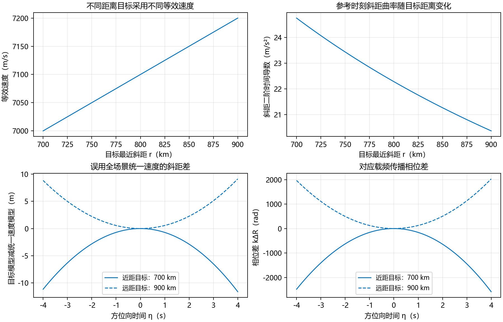

图 12　三个距离目标的速度与相位误差诊断；所有目标的速度在各自孔径内固定。

图 12 上排的横轴是**不同目标的最近斜距**，不是慢时间；下排横轴才是同一目标的慢时间。图中没有任何单目标速度随时间变化的曲线。蓝色实线与虚线分别表示近距和远距目标。此图是几何与相位诊断，不是成像图，因此不采用成像 dB 色标。

该算例采用较明显的跨距离速度差，用来展示不能用一个全场景速度取代 $V_r(r)$；数值不能直接外推为任一真实卫星的误差。相位差也没有被等价解释成实际分辨率、PSLR 或 ISLR 的损失。

### 11.3 精确驻相点与首阶驻相积分比较

选择平滑孔径权：

$$
a(\eta)=\left[1-\left(\frac{\eta}{4\,\mathrm s}\right)^2\right]^4
\quad(|\eta|\le4\,\mathrm s),
\qquad a=0\quad\text{于孔径外}.
\tag{11.2}
$$

式（11.2）无量纲，权函数及其前三阶导数在孔径端点为零，用于减弱端点泄漏。对三个距离及三个距离频率 $f_\tau=-50,0,50$ MHz，分别取 $f_\eta=2(f_c+f_\tau)u_0/c$，使理论驻相时刻为零。

比较式（6.4）的几何积分与式（8.5）的几何因子，去除相同的常数相位 $e^{-jkR_b}$，并不乘共同的 $\sigma P$。定义复数相对误差为 $|I_{\mathrm{SPA}}-I_{\mathrm{num}}|/|I_{\mathrm{num}}|$。载频切面结果如下：

| $r$（km） | $f_\eta$（Hz） | 首阶驻相复谱相对误差 | 最后两级求积的相对变化 |
| --- | --- | --- | --- |
| 700 | 175012.151787 | 4.546629e-05 | 4.902218e-11 |
| 800 | 177512.325384 | 5.050885e-05 | 3.547279e-11 |
| 900 | 180012.498981 | 5.525565e-05 | 1.398422e-11 |

每次积分采用 100001、200001、400001 个等间距采样点的复 Simpson 求积，比较最后两级的变化。九个频率点的理论驻相时刻误差小于 $6\times10^{-14}$ s，完整平方根驻相相位与直接代回相位的浮点差小于 $6\times10^{-8}$ rad；首阶驻相积分仍有非零误差，说明精确驻相点与有限孔径精确频谱不是同一概念。

大多普勒对应连续积分坐标，本节未据此宣称某实际 PRF 已满足采样条件。网格加密结果一致也不是对整个二维频带的严格误差证书。

### 11.4 保留完整平方根与截断相位的差别

固定每个目标在载频处的参考多普勒 $f_\eta=2f_cu_0/c$，于 $f_\tau=50$ MHz 比较式（9.3）的二、三阶截断与完整 $G$。以下为 $|(4\pi r/c)(G_N-G)|$：

| $r$（km） | 保留到二阶的相位差幅值（rad） | 保留到三阶的相位差幅值（rad） |
| --- | --- | --- |
| 700 | 180.823421 | 3.831325 |
| 800 | 206.655338 | 4.378657 |
| 900 | 232.487255 | 4.925989 |

表中相位差只针对指定的频率点与参数，未扣除其他经验拟合项。它说明孔径内常速度并不保证距离频率二阶截断足够；完整平方根避免了这一特定截断误差，但仍有等效几何、驻相和采样误差需要分别检查。

### 11.5 已执行的核验与证据边界

符号检查验证了固定速度时间导数、距离空变导数、解析驻相点关系及平方根的前三阶距离频率导数；正、负距离调频率共 8 个频率点的 Fresnel 公式与直接积分吻合，绝对误差除以脉宽最大约为 $5.736\times10^{-16}$。九个二维频率点均完成三级网格积分。没有生成正式回波或成像结果，没有检验真实星历、真实原始数据、空间场景聚焦质量或物理模型残差。

### 11.6 两种混合域及其变换关系的独立核验

新增核验采用具有解析频谱的高斯调频脉冲，目的是控制积分截断边缘，并检查变换关系与相位符号，不把它替换为附录 E 的矩形脉冲的假设。设置数学测试几何最近斜距 30 km、等效速度 250 m/s、有效斜视 30°、载频 1 GHz、孔径 $[-0.04,0.04]$ s；高斯时间尺度为 0.3 μs，调频率为 $3\times10^{12}$ Hz/s。它是缩放后的算子核验，不代表真实星载系统。

执行三组交叉检查：直接对快时间求积与式（5.4）比较；直接方位变换式（6.1），与先构造二维频谱再按式（6.5）作距离逆变换比较；直接时域相关，与式（5.6）的频域反演及高斯解析相关值比较。距离频率积分采用 $[-12,12]$ MHz 的 4097 点网格，慢时间采用 2001 点网格，并与 1001 点网格比较。

| 检查内容 | 本算例的最大误差 |
| --- | --- |
| 距离频域—方位时域公式，误差除以发射谱峰值 | $1.952\times10^{-15}$ |
| 距离多普勒域的两条连续积分路径，复数相对误差 | $4.961\times10^{-16}$ |
| 慢时间网格加密后的相对变化 | $6.323\times10^{-15}$ |
| 距离压缩自相关，误差除以相关峰值 | $1.992\times10^{-16}$ |

同时用符号运算检查式（C.2）和式（C.3）的原始距离多普勒相位导数。上述误差接近本算例的浮点舍入量级，只说明这些光滑测试点的数值一致性；不证明矩形脉冲边缘、所有实际带宽或任意驻相近似具有同样误差，也不证明式（9.12）的一阶距离频率近似对实际星载参数成立。

## 12. 回到研究任务：逐层选择精度与验证方式

### 12.1 先辨认自己所说的精确是哪一层

图 13　三层误差分别产生于几何模型、积分近似和距离频率截断。某一层精确，不会自动消除其他层的误差。

在这一约定下，推导精确或受控高精度频谱仍有必要，原因包括：保留大斜视的距离与方位耦合；保留完整平方根中的高阶距离频率相位；分析距离空变速度使统一参考滤波器产生的误差；建立可校核的频域前向算子。若只用已知轨道进行时域后向投影，并不一定需要先求闭式频谱。

| 层次 | 含义 | 本文能得到的结果 |
| --- | --- | --- |
| 几何模型 | 用每个目标自己的常数 $V_r(r)$ 构造双曲斜距 | 是对真实星载几何的等效近似，不自动精确等于真实轨道 |
| 精确频谱积分 | 对选定回波模型作有限孔径二维傅里叶变换 | 严格相等的积分及收敛表示 |
| 精确驻相点与相位 | 对双曲斜距的驻相方程解析求解，保留完整平方根 | 模型内不作斜距二次截断、不作驻相点级数反演 |
| 首阶驻相频谱 | 以局部二次相位代替有限孔径振荡积分 | 仍是渐近近似，必须区别幅度、端点和有限孔径误差 |

因此，本模型下可以精确推导驻相点和完整平方根相位，也可以写出严格的有限孔径频谱积分；不能把首阶驻相闭式等同于有限孔径频谱的严格值。真实轨道与等效双曲斜距之间的残差另行检验。

星载高分辨率 SAR 的曲轨、传播时间与空间变化等效速度问题在 [Zeng 等，2013](https://ietresearch.onlinelibrary.wiley.com/doi/10.1049/iet-rsn.2012.0124) 中有原始研究讨论。本文按当前约定重新推导，不把已有论文中的“高精度”直接解释为整个物理传播问题的数学精确性。

### 12.2 按研究目标选择计算路线

| 目的 | 推荐路线 | 误差或适用条件 |
| --- | --- | --- |
| 建立有限孔径参考频谱 | 式（6.4）求积，或对采样回波作二维 DFT | 检查求积、采样、门窗与混叠 |
| 获得严格相等的收敛表示 | 式（B.3）及截断界（B.5） | 理论收敛不保证大载频下双精度稳定 |
| 构造完整平方根相位 | 式（7.3）与（7.5） | 双曲模型内驻相点与相位精确，不需级数反演 |
| 得到高精度闭式谱 | 式（8.5） | 首阶驻相近似；另查端点、幅度变化 |
| 分析 RCMC、SRC 和高阶耦合 | 式（9.3）至（9.7） | 保留 $V_r(r)$，核对实际频带内截断误差 |
| 分析距离空变与统一参考误差 | 式（10.1）至（10.7） | 区分距离偏导与时间导数，声明参数保持方式 |
| 放宽停走传播假设 | 式（D.1）至（D.4） | 迟滞时间、脉内运动和物理模型误差 |

### 12.3 给直接求积一个可控制的基础

若在子区间上 $g(\eta)=a(\eta)e^{-j\Phi(\eta)}$ 二次连续可微，等间距复合梯形公式 $T_h$ 的误差满足：

$$
\left|\int_{\eta_a}^{\eta_b}g(\eta)d\eta-T_h\right|
\le\frac{(\eta_b-\eta_a)h^2}{12}
\sup_{\eta\in I}|g''(\eta)|.
\tag{12.1}
$$

式（12.1）对复函数可用同一个非负误差核与三角不等式推导，因而不是简单把实部、虚部误差分别相加后的猜测。$h$ 是慢时间求积步长，单位 s。对分段光滑孔径，应在所有不光滑点分段后分别应用，最后累加界。

对 $g$ 连续求导两次，完整展开为：

$$
g''=\left[a''-2j\Phi'a'-j\Phi''a-(\Phi')^2a\right]e^{-j\Phi},
\quad
|g''|\le |a''|+2|\Phi'a'|+|\Phi''a|+|\Phi'|^2|a|.
\tag{12.2}
$$

式（12.2）可以把几何导数界和孔径导数界转化成保守的求积误差证书。高振荡时该界通常很松，专门的振荡求积、局部分段和自适应处理会更经济。步长减半后的结果接近是数值诊断；只有配合有效导数界或相应求积误差理论，才能声称已获得严格误差上限。

### 12.4 连续频谱与离散 FFT 的关系

实际矩阵按项目约定“行为慢时间、列为快时间”。对均匀采样，令 $\eta_m=\eta_a+m\Delta\eta$、$\tau_n=\tau_a+n\Delta\tau$，其中 $m,n$ 为整数下标。对应矩形求积为：

$$
S_{\mathrm{sampled}}(f_{\tau},f_\eta)
=\Delta\eta\,\Delta\tau
\sum_{m=0}^{M-1}\sum_{n=0}^{N-1}
s_{mn}e^{-j2\pi[f_\eta\eta_m+f_{\tau}\tau_n]}.
\tag{12.3}
$$

式（12.3）在 DFT 频率格点上可由 FFT 加坐标原点相位和采样间隔因子实现。DFT 对这组有限离散数据是精确的代数变换；它等于连续物理频谱还需要采样、时间窗和混叠误差受控。补零只使频率格点更密，不能修复缺失的轨道相位或原始采样混叠。

如果对方位先乘 $e^{-j2\pi f_{\mathrm{dc}}\eta}$ 去多普勒中心，则新频率 $\widetilde f_\eta$ 与本文频率的关系是 $f_\eta=\widetilde f_\eta+f_{\mathrm{dc}}$，这是傅里叶调制定理直接给出的坐标替换。原始中心模糊、去中心符号和真实频谱支撑都必须核对；不能仅通过图上频谱居中判断采样正确。

### 12.5 带着主线重新读一遍

本次修订把等效速度统一定义为 $V_r(r)$：单个目标的合成孔径时间内为常数，不同距离目标仍有不同数值。所有时间求导和方位傅里叶积分都固定目标标签；只有跨距离分析时才使用 $dV_r/dr$。

两种混合域已明确给出：距离频域—方位时域的精确原始表达式为式（5.4），距离压缩版本为式（5.5）；距离多普勒域的精确原始表达式为式（6.1），距离压缩版本为式（6.2）。四种表示域之间以第 2.1 节的变换约定相互联系。式（9.12）给出常用距离多普勒闭式，但需要额外的幅度冻结与距离频率相位线性化条件。

在等效双曲斜距与停走模型内，式（6.4）是精确有限孔径频谱，式（B.3）提供严格收敛表示；式（7.3）和式（7.5）分别给出精确驻相点与完整平方根相位。因为固定目标的速度时间不变，主推导不再需要时变速度的级数反演。首阶驻相谱（8.5）仍是近似，真实曲轨与双曲模型之间的几何残差仍需单独验证。

保留距离空变速度的必要性，并没有因孔径内速度冻结而消失。$V_r(r)$ 同时进入多普勒、驻相时刻、平方根相位、谱幅度、距离徙动和 SRC。单个参考距离的聚焦结果不能代替全场景验证。

## 13. 参考资料与证据范围

1. Tao Zeng, Wenfu Yang, Zegang Ding, Luosi Liu. *Advanced range migration algorithm for ultra-high resolution spaceborne synthetic aperture radar*. IET Radar, Sonar & Navigation, 7(7), 764–772, 2013. DOI: [10.1049/iet-rsn.2012.0124](https://ietresearch.onlinelibrary.wiley.com/doi/10.1049/iet-rsn.2012.0124)。前版核对了出版方全文网页中的摘要、引言与模型和频谱讨论。本版用于说明曲轨、传播时间和空间变化等效速度的研究背景，不以该文替代本文假设下的代数推导。
2. NIST Digital Library of Mathematical Functions. [§2.3(iv), Method of Stationary Phase](https://dlmf.nist.gov/2.3#iv)。前版已核对原始参考页面；用于区分渐近驻相谱、精确积分和端点贡献。本版按负指数傅里叶约定推导幅度与 $-\pi/4$ 相位。
3. NIST Digital Library of Mathematical Functions. [§7.2(iii), Fresnel Integrals](https://dlmf.nist.gov/7.2#iii)。前版已核对 Fresnel 定义；附录 E 从有限脉冲积分重新配方、换元，保留正负调频率与频带边缘行为。

上述资料的既有访问记录为 2026 年 11 月 2 日。本次修改围绕用户明确的“孔径内时不变、距离空变”约定进行，公式由符号运算及参数化数值算例核验。本资料不是文献系统综述，也不是新算法创新性或真实回波成像性能的证明。

4. ISCE3 官方文档，[Radar Geometry Handling in ISCE](https://isce-framework.github.io/isce3-docs/overview_geometry.html)。区分波束中心和零多普勒几何，并说明零多普勒时刻可能在成像孔径外。2026 年 11 月 4 日核对，用于本版时间原点说明。

## 附录 A. 从真实轨道计算斜距导数（选读）

本附录供需要从星历计算等效参数的读者查阅；第一次阅读可跳过。只在本附录中用 $R$ 简记真实矢量斜距 $R_{\mathrm{true}}$，主线中的 $R$ 仍表示等效双曲模型。向量的点积可理解为取沿某一方向的投影后相乘累加；撇号表示对慢时间求导。

### A.1 同一坐标系中的相对运动

可使用地心惯性系，也可使用地固系；所有位置、速度和加速度必须由同一坐标系中的时间导数得到。以惯性系为例，地面固定目标也会随地球自转运动。定义：

$$
\begin{aligned}
\boldsymbol\rho(\eta)&=\boldsymbol r_s(\eta)-\boldsymbol r_g(\eta),\\
\boldsymbol v(\eta)&=\boldsymbol\rho'(\eta),\\
\boldsymbol a_g(\eta)&=\boldsymbol\rho''(\eta),\\
\boldsymbol b_g(\eta)&=\boldsymbol\rho'''(\eta).
\end{aligned} \tag{A.1}
$$

式（A.1）中 $\boldsymbol r_s$ 是天线相位中心位置，$\boldsymbol r_g$ 是该目标位置；$\boldsymbol\rho$ 为由目标指向平台的相对位置，单位 m。$\boldsymbol v$、$\boldsymbol a_g$、$\boldsymbol b_g$ 分别为相对速度、相对加速度、相对加加速度，单位依次为 m/s、m/s²、m/s³。下标 $g$ 仅用于区分几何加速度与孔径权 $a$，不表示只取目标自身加速度。撇号始终表示对 $\eta$ 求导。

在停走模型中，斜距由向量范数直接给出：

$$
R(\eta)=\|\boldsymbol\rho(\eta)\|,
\qquad Q(\eta)=R^2(\eta)=\boldsymbol\rho\cdot\boldsymbol\rho.
\tag{A.2}
$$

式（A.2）中的 $Q$ 是斜距平方，单位 m²；目标标签暂时省略。这里未作直线轨道、匀速或斜距泰勒截断。本文的“几何精确”以选定的轨道和目标模型为条件，不包含尚未建模的大气、潮汐、相位中心误差等因素。

### A.2 逐次求导，保留径向和横向效应

对 $R^2=\boldsymbol\rho\cdot\boldsymbol\rho$ 两侧求导，左侧用链式法则，右侧对两个因子分别求导：

$$
2RR'=\boldsymbol\rho'\cdot\boldsymbol\rho
+\boldsymbol\rho\cdot\boldsymbol\rho'
=2\boldsymbol\rho\cdot\boldsymbol v,
\qquad
R'=\frac{\boldsymbol\rho\cdot\boldsymbol v}{R}.
\tag{A.3}
$$

式（A.3）说明 $R'$ 是相对速度沿视线的投影，单位 m/s。目标正在接近时 $R'<0$。它不是平台速度的模，也不是后文的等效速度。除以 $R$ 的条件为平台与目标不重合，星载对地观测满足这一条件。

继续对 $RR'=\boldsymbol\rho\cdot\boldsymbol v$ 求导：

$$
(R')^2+RR''
=\boldsymbol v\cdot\boldsymbol v
+\boldsymbol\rho\cdot\boldsymbol a_g,
\qquad
R''=\frac{\boldsymbol v\cdot\boldsymbol v
+\boldsymbol\rho\cdot\boldsymbol a_g-(R')^2}{R}.
\tag{A.4}
$$

式（A.4）的 $R''$ 单位 m/s²。分子中的相对速度平方提供横向运动造成的曲率；$\boldsymbol\rho\cdot\boldsymbol a_g$ 表示相对加速度的视线贡献；减去 $(R')^2$ 是去除速度平方中的径向分量。曲轨、地球自转及斜视条件都可通过这些量进入多普勒调频率。

再对式（A.4）中尚未除以 $R$ 的等式求导。左侧两项导数分别为 $2R'R''$ 和 $R'R''+RR'''$；右侧两项导数分别为 $2\boldsymbol v\cdot\boldsymbol a_g$ 和 $\boldsymbol v\cdot\boldsymbol a_g+\boldsymbol\rho\cdot\boldsymbol b_g$，于是：

$$
3R'R''+RR'''
=3\boldsymbol v\cdot\boldsymbol a_g
+\boldsymbol\rho\cdot\boldsymbol b_g,
\qquad
R'''=\frac{3\boldsymbol v\cdot\boldsymbol a_g
+\boldsymbol\rho\cdot\boldsymbol b_g-3R'R''}{R}.
\tag{A.5}
$$

式（A.5）给出真实斜距三阶时间导数，单位 m/s³。它可用于检查等效模型的高阶几何残差。更高阶导数可继续沿乘积求导构造；本版主推导对等效双曲斜距直接求解驻相方程，不依赖高阶时间级数反演。

### A.3 斜视角、卫星速度与等效速度的区别

定义瞬时几何斜视角 $\theta_{\mathrm{geom}}$：相对速度指向目标的投影为正时取正斜视，即：

$$
\sin\theta_{\mathrm{geom}}(\eta)
=-\frac{\boldsymbol\rho\cdot\boldsymbol v}{R\|\boldsymbol v\|},
\qquad R'=-\|\boldsymbol v\|\sin\theta_{\mathrm{geom}}.
\tag{A.6}
$$

式（A.6）中的角是以相对运动方向定义的视线偏离正侧视的角；若仪器用轨道速度或地面航迹定义斜视角，必须先转换。它描述径向速度，不单独确定斜距曲率。因式（A.4）还含相对加速度，一般不能同时用同一个真实几何角和一个任意等效速度代替所有运动量。

## 附录 B. 精确频谱的收敛级数与误差界（选读）

本附录回答“精确积分是否还能严格展开”。**绝对可积**指幅度的积分有限；**一致收敛**指在整段孔径上都能用同一个余项界控制误差。它们用于证明交换积分与无穷求和是否合法，不是主线驻相近似的前提。

这一节回答“不仅写一个积分，是否还能给出与它严格相等的展开”。方法的数学性质明确，但不主张它是轨道大载频问题最经济的计算方案。

选择常数参考距离 $R_c$，记 $L(\eta)=R(\eta)-R_c$，且有限孔径上 $|L|\le M$。将常数相位提出积分：

$$
\int_I a e^{-j(kR+2\pi f_\eta\eta)}d\eta
=e^{-jkR_c}\int_I a(\eta)e^{-j2\pi f_\eta\eta}
e^{-jkL(\eta)}d\eta.
\tag{B.1}
$$

式（B.1）的 $M$ 单位 m，$kM$ 无量纲。选择靠近孔径内斜距中点的 $R_c$ 可以降低 $M$，但不改变最终频谱。

对实变量相位的指数使用全收敛幂级数：

$$
e^{-jkL(\eta)}
=\sum_{n=0}^{\infty}\frac{(-jk)^nL^n(\eta)}{n!},
\qquad
\left|\frac{(-jk)^nL^n(\eta)}{n!}\right|
\le\frac{(|k|M)^n}{n!}.
\tag{B.2}
$$

式（B.2）右侧上界与 $\eta$ 无关，其总和为有限数 $e^{|k|M}$，从而级数在孔径上一致绝对收敛。乘以可积的 $a$ 后可以逐项积分；这一步给出了交换积分与无穷求和的条件。

定义几何矩频谱并完成代入：

$$
\begin{aligned}
\mu_n(f_\eta)&=\int_I a(\eta)L^n(\eta)e^{-j2\pi f_\eta\eta}d\eta,\\
S(f_{\tau},f_\eta)
&=\sigma P(f_{\tau})e^{-jkR_c}
\sum_{n=0}^{\infty}\frac{(-jk)^n}{n!}\mu_n(f_\eta).
\end{aligned}\tag{B.3}
$$

式（B.3）是第二个核心结果：没有驻相近似的精确收敛表示。若 $a$ 无量纲，$\mu_n$ 单位为 m$^n$·s，与 $k^n$ 相乘后仍为 s。$\mu_n$ 一般仍需计算积分，因此它不是把任意轨道瞬间化为有限个初等函数的方案。

还可以给出截断的严格绝对误差界。令 $x=kL$ 为实数，指数函数关于 $x$ 的泰勒积分余项为：

$$
e^{-jx}-\sum_{n=0}^N\frac{(-jx)^n}{n!}
=\frac{(-j)^{N+1}}{N!}\int_0^x(x-t)^N e^{-jt}dt,
\quad
\left|\text{余项}\right|\le\frac{|x|^{N+1}}{(N+1)!}.
\tag{B.4}
$$

式（B.4）对负 $x$ 也成立：取绝对值后将积分方向反转，再以 $|e^{-jt}|=1$ 估计积分。因而不需要额外乘 $e^{|x|}$ 的较松界。

若 $S_N$ 表示式（B.3）保留至 $n=N$，并令 $\|a\|_1=\int_I|a|d\eta$，则：

$$
|S-S_N|
\le |\sigma P(f_{\tau})|\,\|a\|_1
\frac{(|k|M)^{N+1}}{(N+1)!}.
\tag{B.5}
$$

式（B.5）由积分三角不等式和式（B.4）的统一上界得到，是绝对谱误差界；在频谱零点附近不能把它除以很小的 $|S|$ 当成稳定的相对误差。雷达载频使 $|k|M$ 往往很大，级数中间项可能巨大且强烈抵消，故理论收敛不保证双精度数值稳定；实际更推荐直接振荡积分和分段处理。

## 附录 C. 原始距离多普勒积分的驻相条件（选读）

本附录处理未经距离压缩的距离多普勒积分。这里快时间 $\tau$ 参与原始调频相位，驻相点通常需要隐式求解；它与主线固定距离频率的解析驻相点区别使用。

若直接近似未压缩的式（6.1），应把原始距离调频相位也纳入总相位。固定 $\tau$，令脉冲内偏移为 $u(\eta)=\tau-2R(\eta)/c$，则：

$$
\begin{aligned}
b(\tau,\eta)&=a(\eta)w_r[u(\eta)],\\
\Phi_{\mathrm{RD}}(\tau,\eta)
&=\frac{4\pi f_c}{c}R(\eta)+2\pi f_\eta\eta-\pi K_ru^2(\eta),\\
S_{\mathrm{RD}}(\tau,f_\eta)
&=\sigma\int_I b(\tau,\eta)e^{-j\Phi_{\mathrm{RD}}(\tau,\eta)}d\eta.
\end{aligned}\tag{C.1}
$$

式（C.1）只是重写精确积分，并未近似。$b$ 包含孔径和距离包络，不包含已写进相位的线性调频因子；$u$ 的单位为 s，$\Phi_{\mathrm{RD}}$ 无量纲。原始回波的距离包络边缘可能使有效积分区间比完整孔径更短。

因为 $u'=-2R'/c$，对总相位逐项求导：

$$
\begin{aligned}
\frac{\partial\Phi_{\mathrm{RD}}}{\partial\eta}
&=\frac{4\pi f_c}{c}R'+2\pi f_\eta-2\pi K_ruu'\\
&=\frac{4\pi}{c}(f_c+K_ru)R'+2\pi f_\eta,\\
\frac{V_r^2(r)(\eta_\star-\eta_{\min})}{R(\eta_\star)}
&=-\frac{cf_\eta}{2\{f_c+K_r[\tau-2R(\eta_\star)/c]\}}.
\end{aligned}\tag{C.2}
$$

式（C.2）最后一行令前两行导数为零，并代入式（3.7）；分母非零时才可这样除法。$\eta_\star$ 是原始距离多普勒积分的驻相点，与第 7 节固定 $f_\tau$ 的 $\eta_s$ 区别使用。$f_c+K_ru$ 是脉冲当前位置对应的瞬时射频频率，因此驻相点依赖 $\tau$。只有另行证明距离调频贡献可忽略时，才能把它近似替成 $f_c$。

继续对第二行求导，使用 $(f_c+K_ru)'=-2K_rR'/c$：

$$
\frac{\partial^2\Phi_{\mathrm{RD}}}{\partial\eta^2}
=\frac{4\pi}{c}\left[(f_c+K_ru)R''
-\frac{2K_r}{c}(R')^2\right].
\tag{C.3}
$$

式（C.3）单位为 rad/s²，包含距离调频引入的第二项，不能照搬只含 $kR''$ 的曲率。若要直接采用原始距离多普勒驻相法，应求出所有在有效脉冲与孔径内部、且曲率非零的根，并计算：

$$
S_{\mathrm{RD}}(\tau,f_\eta)\approx
\sigma\sum_{\eta_\star} b(\tau,\eta_\star)
\sqrt{\frac{2\pi}{|\Phi_{\mathrm{RD}}''(\tau,\eta_\star)|}}
\exp\left[-j\Phi_{\mathrm{RD}}(\tau,\eta_\star)
-j\frac\pi4\operatorname{sgn}\Phi_{\mathrm{RD}}''(\tau,\eta_\star)\right].
\tag{C.4}
$$

式（C.4）是首阶近似而非精确闭式；每个根使用自己的幅度、相位及曲率符号。还需要幅度缓变、局部二次相位有效和端点贡献可控等条件。原始距离包络边缘、曲率退化或多个驻相点接近时，应回到式（6.1）或使用相应一致近似。第 9.3 节采用另一条更便于联系 RCMC 与 SRC 的路线：先构造二维驻相谱，再对距离频率反演。

## 附录 D. 传播期间平台仍在运动：迟滞时间模型（选读）

本附录用于理解停走近似之外还缺少哪些物理因素。**迟滞时间**指发射、目标散射、接收发生在不同真实时刻，需要分别求解；不是一种新的频率坐标。

### D.1 发射、散射、接收时刻不能合并

本文主体的精确性以式（4.4）为边界。若需考虑传播期间平台运动，令 $t_T,t_B,t_R$ 分别为发射、目标散射、接收的绝对时刻。真空中单次散射的迟滞时间关系是：

$$
\begin{aligned}
c(t_B-t_T)&=\|\boldsymbol r_g(t_B)-\boldsymbol r_s(t_T)\|,\\
c(t_R-t_B)&=\|\boldsymbol r_s(t_R)-\boldsymbol r_g(t_B)\|.
\end{aligned}\tag{D.1}
$$

式（D.1）把两个不同端点的路径分别计算，自动保留了传播时间内平台和目标的运动。它们在已知发射或接收时刻时构成待求散射与另一端时刻的隐式方程。这里只讨论欧氏空间、真空、单次散射；若考虑大气和相对论钟差，还需修正传播与时间模型。

令 $\mathcal D=t_R-t_T$，$L_T=c(t_B-t_T)$，$L_R=c(t_R-t_B)$，则：

$$
\mathcal D=\frac{L_T+L_R}{c},
\qquad R_{\mathrm{eff}}=\frac{L_T+L_R}{2}.
\tag{D.2}
$$

式（D.2）定义往返总时延和有效半路径。$R_{\mathrm{eff}}$ 不必等于任一共同时间的几何范数。对单个脉冲中心，若仅修正这条路径，常可构造比停走更准确的有效距离模型；是否足够仍要检查脉内变化。

### D.2 时延若还依赖快时间，距离变换不能直接分离

以接收参考时刻 $t_{\mathrm{ref}}(\eta)$ 定义绝对接收时刻 $t_R=t_{\mathrm{ref}}(\eta)+\tau$。若迟滞求解给出的时延是 $\mathcal D(\tau,\eta)$，下变频后的广义回波可写为：

$$
s_{\mathrm{ret}}(\tau,\eta)
=\sigma A(\tau,\eta)
p\!\left[\tau-\mathcal D(\tau,\eta)\right]
e^{-j2\pi f_c\mathcal D(\tau,\eta)}.
\tag{D.3}
$$

式（D.3）用 $A$ 容纳传播幅度、天线及必要的时变尺度因子；发射参考包络的已知时间偏置应在 $p$ 的自变量中一并计入。与式（4.4）不同，$\mathcal D$ 随快时间变化时，变量替换 $u=\tau-\mathcal D$ 的导数不再恒为 1，可能产生波形伸缩和额外调制。

因此更一般的精确频谱是：

$$
S_{\mathrm{ret}}(f_{\tau},f_\eta)
=\int_I\int_{\mathbb R}
s_{\mathrm{ret}}(\tau,\eta)
e^{-j2\pi(f_{\tau}\tau+f_\eta\eta)}
\,d\tau\,d\eta.
\tag{D.4}
$$

式（D.4）依然是模型内精确傅里叶积分，但不能未经推导就简化成 $P(f_{\tau})$ 乘一个一维方位积分。若经误差分析确认脉内时延变化可以忽略，才可令 $\mathcal D=\mathcal D(\eta)$，并以 $R_{\mathrm{eff}}=c\mathcal D/2$ 回到式（5.3）和式（6.4）的结构。

结论是：在孔径内固定 $V_r$ 并保留它的距离空变，描述的是当前采用的**等效几何**，却不会自动修正传播时间、脉内运动、大气色散、硬件相位或多次散射。论文中应同时声明几何模型、传播模型和谱近似层次。

## 附录 E. 有限矩形调频脉冲的精确 Fresnel 频谱（选读）

本附录给出矩形有限长脉冲的精确距离频谱。**Fresnel 积分**只是为两种特定振荡函数的积分起的名字；不用记忆特殊函数性质，也能沿着配方和换元核对推导。

为给出一个不依赖驻相法的距离频谱，取 $w_r(u)=1$ 于 $[-T_p/2,T_p/2]$，其他位置为零，且 $K_r\ne0$。对指数中的二次式配方：

$$
\pi K_ru^2-2\pi f_{\tau}u
=\pi K_r\left(u-\frac{f_{\tau}}{K_r}\right)^2
-\frac{\pi f_{\tau}^2}{K_r}.
\tag{E.1}
$$

式（E.1）通过展开右侧平方可逐项核对：交叉项恰为 $-2\pi f_{\tau}u$，常数项相消。该步骤不要求大时宽带宽积。

定义无量纲变量及上下限：

$$
z=\sqrt{2|K_r|}\left(u-\frac{f_{\tau}}{K_r}\right),
\qquad
z_\pm=\sqrt{2|K_r|}\left(\pm\frac{T_p}{2}-\frac{f_{\tau}}{K_r}\right).
\tag{E.2}
$$

式（E.2）使 $du=dz/\sqrt{2|K_r|}$，二次相位变成 $\operatorname{sgn}(K_r)\pi z^2/2$。$\operatorname{sgn}$ 是符号函数，正调频和负调频均包含在内。

用 Fresnel 函数定义：

$$
C(z)=\int_0^z\cos\left(\frac{\pi t^2}{2}\right)dt,
\qquad
\mathcal S(z)=\int_0^z\sin\left(\frac{\pi t^2}{2}\right)dt.
\tag{E.3}
$$

式（E.3）的两个函数均无量纲；用 $\mathcal S$ 与二维频谱 $S$ 区分。定义与 [NIST DLMF §7.2(iii)](https://dlmf.nist.gov/7.2#iii) 一致。

由欧拉公式把复指数分成余弦和正弦，再以式（E.3）分别积分：

$$
\begin{aligned}
P(f_{\tau})
&=\frac{e^{-j\pi f_{\tau}^2/K_r}}{\sqrt{2|K_r|}}
\Big\{C(z_+)-C(z_-)\\
&\qquad+j\operatorname{sgn}(K_r)
[\mathcal S(z_+)-\mathcal S(z_-)]\Big\}.
\end{aligned}\tag{E.4}
$$

式（E.4）是有限矩形线性调频脉冲的精确频谱，包含带边过渡和纹波。它不同于常用的 $e^{-j\pi f_{\tau}^2/K_r}$ 乘矩形谱近似。$K_r=0$ 时应回到式（5.2）直接得到有限矩形脉冲的 sinc 频谱，不能使用含 $1/K_r$ 的式（E.4）。

## 附录 F. 术语与符号速查

| 术语或记号 | 入门读法 | 在本文怎样使用 |
| --- | --- | --- |
| 相干叠加 | 连幅度和相位一起相加 | 图 2、方位积分 |
| 复共轭 $z^*$ | 虚部变号、相位反号 | 匹配滤波得到 $PP^*=\lvert P\rvert^2$ |
| 傅里叶变换 | 分解不同振荡频率的复幅度 | 图 3 的四域变换 |
| 积分核 | 积分中负责把输入变成输出的那部分函数 | 场景前向核 $K$ |
| 前向模型 / 算子 | 给出目标与参数，计算会收到什么回波或频谱 | 从散射场到数据的映射 |
| 偏导数 | 只变一个变量，其余固定 | 时间导数与距离空变导数 |
| 驻相点 | 积分总相位对时间的斜率为零的位置 | 瞬时多普勒等于所选方位频率 |
| 非退化 | 此处指二阶相位导数不为零 | 可以使用局部二次相位近似 |
| 渐近 | 研究指定参数趋向某个极限时的主导行为 | 首阶驻相谱有余项 |
| Taylor / 泰勒展开 | 用某一点各阶导数构造局部多项式 | 距离频率展开与 SRC |
| $O(x^n)$ | 余项在局部可由常数乘 $\lvert x\rvert^n$ 控制 | 不表示余项已为零，系数需带相应单位 |
| $\sup$ | 上确界，可先理解为要控制的最大值 | 整个处理频带的误差界 |
| 频谱支撑 / 处理频带 | 信号保留或显著非零的频率范围 | 有限窗会产生带外泄漏，不能随意当成严格零 |
| 群时延 | 相位对频率的斜率除以 $2\pi$ | 定位距离脉冲中心 |
| 雅可比 | 换坐标时的长度、面积或体积缩放 | 场景散射密度的积分测度 |
| $L^2$ / 平方可积 | 信号总能量有限 | 在均方意义下解释傅里叶反演 |
| 正则化 | 先加一个便于计算的小衰减，再取极限 | 振荡高斯积分 |
| 平方根的分支 | 平方根有两个符号，需按条件选定连续的一支 | 复高斯积分从正实部连续取极限 |
| RCMC | 让不同方位频率下的距离脉冲中心对齐 | 不是同时消去所有高阶相位 |
| SRC | 处理几何引入的二次距离频率相位 | 不等于只对发射 LFM 做匹配滤波 |

如果术语打断阅读，先用本表的中间一列继续理解物理过程，再回到公式核对具体定义。主线的框内公式索引见附录 G。

## 附录 G. 框内公式与复现入口

| 反复使用的关系 | 公式编号 | 应同时记住的条件 |
| --- | --- | --- |
| 时间不变、距离空变 | （3.1） | 对同一目标固定 r；跨目标才改变 r |
| 以波束中心为原点的斜距 | （3.4） | 有效角；等效双曲模型 |
| 最近斜距形式 | （3.6） | 最近时刻不等于波束中心 |
| 全场景公共时间轴 | （3.11） | 不同目标的波束中心时刻可以不同 |
| 原始时域回波 | （4.4） | 停走、完整接收、单次散射 |
| 距离频域—方位时域 | （5.4） | 未作方位变换 |
| 距离匹配滤波自相关 | （5.6） | 只对发射波形取共轭 |
| 原始距离多普勒精确积分 | （6.1） | 距离调频相位仍在积分中 |
| 距离压缩后的距离多普勒精确积分 | （6.2） | 不等于已完成 RCMC/SRC |
| 二维频谱精确积分 | （6.4） | 当前等效模型内 |
| 驻相条件 | （7.1） | 总相位对方位时间的导数为零 |
| 解析驻相时刻 | （7.3） | 根在有效孔径内 |
| 完整平方根驻相相位 | （7.5） | 不等于精确有限孔径谱 |
| 首阶二维驻相谱 | （8.5） | 缓变幅度、非退化、端点可控 |
| 几何群时延 | （9.5） | 对应驻相相位的导数 |
| 二次距离压缩因子 | （9.6） | 只消除指定二阶相位 |
| 常用距离多普勒闭式 | （9.12） | 还需幅度冻结和距离频率线性化 |
| 斜距差到相位差 | （10.6） | 阈值是诊断，不是图像质量通用判据 |

本目录 Markdown 是唯一正文源，PDF 由同一源排版，图示也随正文顺序插入。生成插图使用 `tools/spaceborne_squint_spectrum/illustrate_derivation.py`；数学核验使用同目录的 `verify_derivation.py` 与 `verify_mixed_domains.py`；导出和内容检查使用 `build_pdf.cjs` 与 `check_pdf.py`。临时页面和检查清单保存在 `scratch/spaceborne_squint_spectrum`。

本次重编了章节与公式编号，旧版本由 Git 保存。全部原有 93 个编号公式均保留在主线或选读附录中，新增的复数与波束中心公式也已编号。图与说明均是教学模型示意，数值结论的条件以正文和核验记录为准。

此前讨论的旧式（4.4）现为式（3.6）；其 $\eta_c$ 已统一改名为 $\eta_{\min}$。式（3.11）补充了全场景公共时间轴的写法，避免将所有目标的波束中心都误设为同一个时刻。
